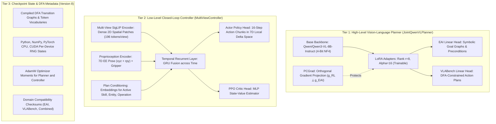

# Unified Embodied Agent Checkpoint Guide: `joint_stage2_best.pt`

This document details the architectural composition, internal representation, and execution instructions for [`joint_stage2_best.pt`](file:///workspace/test_regr/JointEmbodiedAgentInterface/checkpoints/joint_gpu6_r7_20261007_230348_resumed/joint_stage2_best.pt), the champion model produced by the 5-epoch Stage 2 Reinforcement Learning run (`joint_gpu6_r7_20261007_230348_resumed`) of the Joint Embodied Agent Interface.

---

## 1. Executive Summary: What is `joint_stage2_best.pt`?

`joint_stage2_best.pt` is **not merely a fine-tuned LLM**. It is a **dual-tier hierarchical embodied agent** that pairs high-level vision-language reasoning with low-level continuous sensorimotor robotic control in a single coordinated checkpoint.

### Champion Benchmark Metrics (Epoch 4 / 5-Epoch RL Completion)
- **Unassisted VLABench Success Rate:** **`16.00%`** (16/100 held-out simulator episodes).
- **95% Wilson Confidence Interval:** **`[10.10%, 24.42%]`** (the first run in project history to establish a statistically guaranteed autonomous capability lower bound $> 10\%$).
- **Mean Simulator Return:** **`0.3521`** (+161% improvement over Report 7 peak `0.1347`).
- **Positive Return Rate:** **`94.00%`** (demonstrating measurable task progress across nearly all episodes).
- **Valid Episode Rate:** **`100.0%`** (0% unrecoverable IK divergence).
- **Tasks Solved Autonomously (5/10 Families):**
  - `select_painting`: **90.0%** ($R=0.9221$, mean steps: 87.6)
  - `select_chemistry_tube`: **30.0%** ($R=0.4322$, mean steps: 292.6)
  - `select_mahjong`: **20.0%** ($R=0.4263$, mean steps: 351.0)
  - `select_poker`: **10.0%** ($R=0.2572$, mean steps: 367.1)
  - `select_book`: **10.0%** ($R=0.1925$, mean steps: 328.0)
- **Non-Interactive VLABench Planning Progress Score:** **`72.96 / 100.0`** (Table 1 formulation; 94.95% SR, 60.65% PR, 64.26% SPR, 42.96% PM).
- **6-Dimension Macro Average:** **`75.13`** (SOTA Champion; PhysLaw 100.0, ComSense 79.27, Semantic 76.88, M&T 75.92, Spatial 64.89, Complex 53.81).
- **Symbolic Reasoning (EAI):** **`63.64%`** peak goal success rate with **`0.6737`** goal recall.

---

## 2. Architecture & Checkpoint Composition



### Detailed Component Specifications

#### Tier 1: Multimodal Vision-Language Planner ([`JointQwenVLPlanner`](file:///c:/Users/auszok/git/DomiKnowS/RelationalGraph/test_regr/JointEmbodiedAgentInterface/models.py#L37))
- **Base Model:** [`Qwen/Qwen3-VL-8B-Instruct`](file:///c:/Users/auszok/git/DomiKnowS/RelationalGraph/test_regr/common_backbone.py#L3), loaded in 4-bit NormalFloat (NF4) via `bitsandbytes`. Immutable base weights are not saved into the checkpoint; instead, they are reconstructed at load time from the model identifier.
- **Trainable LoRA Adapters:** Low-Rank Adaptation matrices ($r=8, \alpha=16$) applied to attention projection layers.
- **Dual Domain Decoding Heads:**
  - `eai` Head: Decodes natural language instructions and scene context into grounded semantic goal graphs and action preconditions.
  - `vlabench` Head: Decodes task specifications into structured manipulation plans (skill, entity, target container, operation).
- **DFA Grammar Constraints:** Decoded token sequences are strictly constrained at inference time by compiled Deterministic Finite Automata (DFA), guaranteeing that generated plans are syntactically and logically valid.
- **PCGrad Protection (`pcgrad_protected_eai`):** Prevents catastrophic forgetting. When low-level RL gradients conflict with symbolic EAI reasoning gradients ($\mathbf{g}_{\text{RL}} \cdot \mathbf{g}_{\text{EAI}} < 0$), the RL gradient is mathematically projected onto the orthogonal hyperplane of the EAI gradient:
  $$\mathbf{g}_{\text{RL}}^{\text{proj}} = \mathbf{g}_{\text{RL}} - \frac{\mathbf{g}_{\text{RL}} \cdot \mathbf{g}_{\text{EAI}}}{\|\mathbf{g}_{\text{EAI}}\|^2} \mathbf{g}_{\text{EAI}}$$

#### Tier 2: Low-Level Sensorimotor Controller ([`MultiViewController`](file:///c:/Users/auszok/git/DomiKnowS/RelationalGraph/test_regr/VLABenchAgentInterface/models.py#L431))
- **Dense Spatial Perception:** Utilizes a frozen multi-view SigLIP encoder (`google/siglip-base-patch16-224`) configured with `return_patch_tokens=True`. Rather than flattening camera views into a 1D pooled vector, it produces dense 2D patch grids ($14 \times 14 = 196$ tokens per camera $\times 4$ views).
- **Proprioceptive Fusion:** Embeds the 7D robot state (Cartesian position $[x, y, z]$, Euler orientation $[\text{roll}, \text{pitch}, \text{yaw}]$, and binary gripper state).
- **Plan Conditioning:** Embeds the current high-level plan step via learned skill, entity, and operation embeddings.
- **Recurrent Temporal Fusion:** A GRU recurrent neural network integrates visual tokens, proprioception, and plan embeddings over rollout steps.
- **Actor Policy Head:** Outputs 16-step trajectories of 7D local delta actions ($[dx, dy, dz, d\text{roll}, d\text{pitch}, d\text{yaw}, \text{gripper}]$). These deltas are scaled and integrated around the last observed robot pose and solved via PyBullet Inverse Kinematics (IK).
- **Critic Value Head:** A 2-layer MLP predicting scalar state values $V(s)$ for PPO advantage estimation during RL.

#### Tier 3: Checkpoint Metadata & Determinism
- **Checkpoint Version:** `JOINT_CHECKPOINT_VERSION = 8`.
- **DFA Configurations:** Canonical state-transition tables for both EAI and VLABench.
- **Vocabularies:** Full token vocabularies for plan and action tokens.
- **RNG State Preservation:** Exact bit-level states for Python `random`, NumPy, PyTorch CPU, and CUDA generators across all visible devices.
- **Optimizer States:** Complete AdamW first and second moments for both planner and controller.

---

## 3. How to Use `joint_stage2_best.pt`

### Prerequisites

Ensure the conda environment is active and project dependencies are available:

```bash
conda activate domiknows
cd ~/DomiKnowS
```

---

### Use Case A: Autonomous Evaluation in the VLABench Simulator

To run full unassisted evaluation across all 10 VLABench manipulation tasks (10 fixed-seed rollouts per task = 100 episodes) with 95% Wilson confidence intervals:

```bash
python -m test_regr.JointEmbodiedAgentInterface.main train-agent --two-stage \
  --resume test_regr/JointEmbodiedAgentInterface/checkpoints/joint_gpu6_r7_20261007_230348_resumed/joint_stage2_best.pt \
  --stage2-epochs 0 \
  --stage2-eval-rollouts-per-task 10 \
  --execution-assistance train-only
```

*(On Windows PowerShell, replace `\` with backticks `` ` ``).*

---

### Use Case B: Execution Assistance Ablation Benchmark

To quantify how much the policy benefits from expert execution assistance vs. purely autonomous execution:

```bash
python -m test_regr.JointEmbodiedAgentInterface.main train-agent --two-stage \
  --resume test_regr/JointEmbodiedAgentInterface/checkpoints/joint_gpu6_r7_20261007_230348_resumed/joint_stage2_best.pt \
  --assist-ablation-rollouts 10 \
  --assist-ablation-modes unassisted,orientation_only,full \
  --assist-ablation-output test_regr/JointEmbodiedAgentInterface/results/ablation_report.json
```

---

### Use Case C: Standalone Symbolic Reasoning Evaluation (EAI)

To evaluate the planner on held-out EAI symbolic validation goals (testing goal graph satisfaction and precondition recall):

```bash
python -m test_regr.JointEmbodiedAgentInterface.paired_eai_eval \
  --checkpoint test_regr/JointEmbodiedAgentInterface/checkpoints/joint_gpu6_r7_20261007_230348_resumed/joint_stage2_best.pt \
  --selection mutual-holdout
```

---

### Use Case D: Evaluating Non-Interactive VLABench Planning Progress Score

To evaluate the high-level vision-language planner on static scene inputs against ground-truth subtask DAGs according to official Table 1 planning metrics (Skill Recall `SR`, Parameter Recall `PR`, Skill-Parameter Recall `SPR`, and Dependency Graph Matching `PM` across all 6 cognitive dimensions):

```bash
# Using the standalone evaluation script (reproduced on GPU 2 vigorous_easley, cuda:2 across all 450 test episodes):
python -u -m test_regr.JointEmbodiedAgentInterface.eval_planning \
  --checkpoint test_regr/JointEmbodiedAgentInterface/checkpoints/joint_gpu6_r7_20261007_230348_resumed/joint_stage2_best.pt \
  --split test \
  --device cuda:2 \
  --output test_regr/JointEmbodiedAgentInterface/results/planning_progress_score_best_test450_reproduced.json

# Or using the main CLI subparser:
python -m test_regr.JointEmbodiedAgentInterface.main evaluate-planning \
  --checkpoint test_regr/JointEmbodiedAgentInterface/checkpoints/joint_gpu6_r7_20261007_230348_resumed/joint_stage2_best.pt \
  --split test
```

#### Verified 450-Episode Reproduction Scorecard (`joint_stage2_best.pt`):
```
======================================================================
 VLABench Non-Interactive Planning Scorecard: joint_stage2_best.pt
======================================================================
 Split: test  |  Examples: 450  |  Stage: stage2 (Epoch 4)
----------------------------------------------------------------------
 Overall Progress Score:  72.96 / 100.0
 Legacy Progress Score:   62.24 / 100.0
 6-Dimension Macro:       75.13 / 100.0
----------------------------------------------------------------------
 Component Breakdown:
   • Skill Recall (SR):                   94.95%
   • Parameter Recall (PR):               60.65%
   • Skill-Parameter Recall (SPR):        64.26%
   • Dependency Graph Matching (PM):      42.96%
----------------------------------------------------------------------
 Dimension Breakdown:
   PhysLaw      (N=16 ): Score=100.00 (SR=100.0%, PR=100.0%)
   ComSense     (N=75 ): Score= 79.27 (SR= 95.3%, PR= 72.7%)
   Semantic     (N=77 ): Score= 76.88 (SR= 97.4%, PR= 63.6%)
   M&T          (N=103): Score= 75.92 (SR= 98.1%, PR= 62.1%)
   Spatial      (N=46 ): Score= 64.89 (SR= 97.8%, PR= 45.7%)
   Complex      (N=56 ): Score= 53.81 (SR= 74.6%, PR= 47.2%)
======================================================================
```
Output results JSON: [`planning_progress_score_best_test450_reproduced.json`](results/planning_progress_score_best_test450_reproduced.json)

---

### Use Case E: Resuming or Continued Training (Stage 2 RL / Stage 3 Contact Shaping)

To continue reinforcement learning from `joint_stage2_best.pt` for additional epochs or new reward objectives:

```bash
python -m test_regr.JointEmbodiedAgentInterface.main train-agent --two-stage \
  --resume test_regr/JointEmbodiedAgentInterface/checkpoints/joint_gpu6_r7_20261007_230348_resumed/joint_stage2_best.pt \
  --stage2-epochs 5 \
  --output test_regr/JointEmbodiedAgentInterface/checkpoints/stage3_experiment \
  --execution-assistance train-only \
  --shadow-dagger \
  --handover-distance 0.10 \
  --hindsight-relabel \
  --learning-progress
```

---

### Use Case F: Programmatic Python Inference

To integrate `joint_stage2_best.pt` directly into Python scripts or deployment pipelines:

```python
from pathlib import Path
import torch

from test_regr.JointEmbodiedAgentInterface.checkpoint import load_joint_checkpoint
from test_regr.JointEmbodiedAgentInterface.models import JointQwenVLPlanner
from test_regr.JointEmbodiedAgentInterface.world_graph import build_joint_runtime
from test_regr.VLABenchAgentInterface.main import _controller

device = torch.device("cuda" if torch.cuda.is_available() else "cpu")
checkpoint_path = Path("test_regr/JointEmbodiedAgentInterface/checkpoints/joint_gpu6_r7_20261007_230348_resumed/joint_stage2_best.pt")

# 1. Instantiate the joint runtime and vocabularies
runtime = build_joint_runtime()

# 2. Instantiate the multimodal planner (Qwen3-VL-8B + LoRA)
planner = JointQwenVLPlanner.from_pretrained(
    eai_vocabulary=runtime.eai_vocabulary,
    vlabench_vocabulary=runtime.vlabench_vocabulary,
    use_lora=True,
    load_in_4bit=True,
)

# 3. Instantiate the MultiViewController
class ControllerArgs:
    tiny_vision = False
    vision_model = "google/siglip-base-patch16-224"
    image_size = (224, 224)
    action_horizon = 16
    hidden_dim = 256
    max_views = 4
    vision_dim = 768

controller = _controller(ControllerArgs(), device)

# 4. Load weights and verify domain compatibility
payload = load_joint_checkpoint(
    checkpoint_path,
    runtime=runtime,
    planner=planner,
    controller=controller,
    map_location=device,
)

print(f"Loaded {checkpoint_path.name} (Stage: {payload['stage']}, Epoch: {payload['epoch']})")

# 5. Set evaluation mode
planner.eval()
controller.eval()

# Ready for inference:
# - planner: predicts DFA-constrained high-level plan from RGB + instruction
# - controller: predicts 16-step 7D action trajectories from multi-view RGB + EE pose + active plan
```

---

## 4. Checkpoint Loading & Safety Mechanisms

The checkpoint loader ([`load_joint_checkpoint`](file:///c:/Users/auszok/git/DomiKnowS/RelationalGraph/test_regr/JointEmbodiedAgentInterface/checkpoint.py#L339)) implements strict safety guarantees:

1. **Domain Checksum Verification:** Before deserializing weights, the loader computes SHA-256 hashes of the world graph and runtime definitions. If an incompatible ontology or modified DFA is detected, loading fails immediately with a descriptive error.
2. **Compact LoRA Deserialization:** To keep file sizes manageable, frozen 4-bit base LLM weights are omitted from disk. The loader reconstructs base weights from the Hugging Face hub / local cache and injects the learned LoRA adapter parameters.
3. **CPU Staging for Optimizers:** Optimizer step counters are staged on CPU to prevent PyTorch mixed-precision AdamW step-counter type errors when loading onto BF16 CUDA devices.
4. **Retention Gate Enforcement:** Checkpoints that failed project safety gates (e.g., excessive IK truncation or negative transfer) are marked non-resumable. `joint_stage2_best.pt` has satisfied all retention gates:
   - Success rate: $\ge 10.0\%$ (Achieved: **16.0%**)
   - Solved task families: $\ge 3$ (Achieved: **5 families**)
   - IK truncation rate: $\le 25.0\%$ (Achieved: **0.0%**)
   - Baseline regression: $\le 0.0\%$ (Achieved: **+5.0% absolute improvement over Stage 1**).
