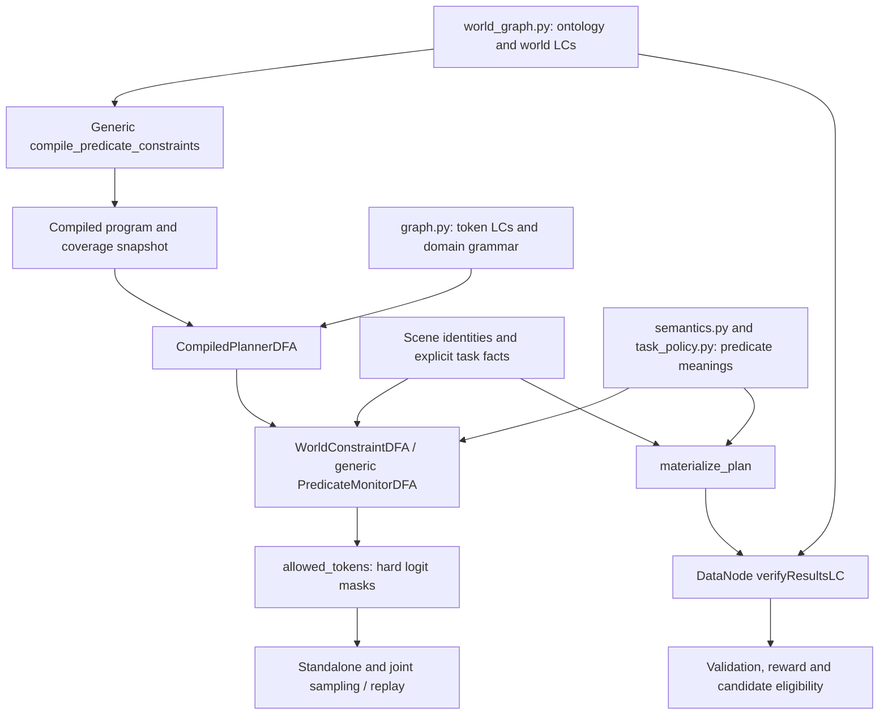

# DomiKnowS Logical Constraints in VLABench: Specification and Components

Source-aligned reference, updated 2026-10-17. This document describes the graph-constrained planner in `test_regr/VLABenchAgentInterface` and its integration with `test_regr/JointEmbodiedAgentInterface`. Native/raw generation is a separate evaluation mode and does not receive these decoding masks.

## 1. Current architecture

World logical constraints drive both incremental decoding and completed-plan verification. The generic compiler reads the actual logical expressions and registered predicate identities; constraint names are diagnostic labels. VLABench supplies the predicate meanings, token adapter, and request facts.



The compilation and binding sequence is:

1. `create_planner_generation_graph` declares token-level LCs.
2. `compile_planner_dfa` intersects the token-constraint DFA with the domain grammar derived from skill signatures and complete subtask patterns. It also calls `compile_world_constraints` to attach the compiled world program.
3. `bind_vlabench_contextual_dfa` binds scene identities and task requirements to that program, producing `WorldConstraintDFA`.
4. Sampling masks logits with this bound policy. Replay retains the same policy and token budget.
5. `materialize_plan(..., policy=policy)` reuses the bound task requirements for completed-plan verification. Alternatively, callers can provide `task_context=...` or `task_name=...`.

An unbound `CompiledPlannerDFA` recognizes the grammar only. Context-free planner entry points reject an unbound program with active semantic rules. Supplying only the grammar is not semantic enforcement.

## 2. Complete default world-constraint inventory

`build_vlabench_world_graph` declares **41 active head constraints** by default: 15 existing named rules, eight grounded planning rules, and 18 generated skill-argument rules. Custom builders and `include_default_constraints=False` can change this inventory.

In the formulas below, `O(op)` means `operation(op)`, `T(e)` means `transition(e)`, and `S_s(op)` means the skill predicate for skill `s`. Predicate meanings are executable definitions, not additional quantified formulas silently inferred from their names.

| Constraint name | Declared implication | Grounded meaning |
|---|---|---|
| `operation_exactly_one_skill` | `O(op) -> valid_skill_type(op)` | The skill name is in the declared signature map. Materialization assigns one-hot skill facts; this LC itself is an implication, not an existential cardinality formula. |
| `operation_schema_is_valid` | `O(op) -> valid_operation(op)` | Required target arguments are present and valid, and forbidden target arguments are absent. |
| `operation_pointer_is_valid` | `O(op) -> valid_pointer(op)` | Every supplied entity/container pointer resolves in the current scene. |
| `transition_matches_subtask_pattern` | `T(e) -> allowed_transition(e)` | Materialization grounds this from full plan validation, including complete subtask-pattern membership. The token grammar independently enforces the declared pattern language. |
| `button_entity_requires_press_skill` | `targets_button(op) -> S_press(op)` | An operation referencing a button must use `press`. |
| `press_requires_button_target` **(new)** | `S_press(op) -> targets_button(op)` | A press must target a button. This is the converse of the preceding rule and adds a restriction. |
| `task_skill_sequence` **(new)** | `O(op) -> task_skill_allowed(op)` | At operation index `i`, the skill must equal the declared sequence's skill at `i`, when a sequence is specified. |
| `task_initial_target` **(new)** | `O(op) -> task_target_allowed(op)` | The first operation must reference the specified initial target when one is supplied. Later operations are not forced to reuse that target. |
| `task_sequence_completion` **(new)** | `O(op) -> task_sequence_complete(op)` | On the last operation, the completed operation count must equal the declared sequence length. Nonfinal operations receive a true completion fact. |
| `anti_self_placement` | `O(op) -> not is_self_placement(op)` | The placement destination cannot equal the subject, using the held entity when the operation omits an explicit subject. |
| `pick_excludes_static_fixtures` | `O(op) -> not targets_static_fixture(op)` | A pick cannot target a recognized static fixture. |
| `no_redundant_repeated_picks` | `T(e) -> not repeated_pick_entity(e)` | Consecutive picks of the same resolved entity are forbidden. This is not a global prohibition on revisiting previously picked objects. |
| `container_destination_consistency` | `T(e) -> not inconsistent_container(e)` | A container operation must match the explicit object-specific destination, or the global `task_target_container` fallback. Different objects can have different destinations; an earlier placement does not invent a destination requirement. |
| `open_before_enclosed_placement` | `T(e) -> not unopened_container_placement(e)` | `place`, `pour`, or `insert` into a recognized enclosed container requires that container or its named door/lid to have been opened. |
| `composite_subgoal_completion` | `O(op) -> not premature_composite_eos(op)` | The last operation must meet the selected composite task's minimum operation count and required-skill set. |
| `skill_argument__{name}__{key}` | `S_name(op) -> flag_key(op)` or `S_name(op) -> not flag_key(op)` | Two rules per skill declare presence or absence of the two supported target argument roles. |

The four new declarations are:

```python
ifL(skills["press"]("op"), targets_button("op"), name="press_requires_button_target")
ifL(operation("op"), task_skill_allowed("op"), name="task_skill_sequence")
ifL(operation("op"), task_target_allowed("op"), name="task_initial_target")
ifL(operation("op"), task_sequence_complete("op"), name="task_sequence_completion")
```

### Grounded planning rules in both domains

All eight rules are actual LCs compiled by the shared predicate compiler. For each family `F`, the declaration is:

```python
ifL(andL(parent("x"), applicable_F("x")), satisfied_F("x"), name="grounded__" + F)
```

`parent` is the operation concept, except that `goal_completion` uses the episode/plan root. Applicability requires a relevant operation and at least one decidable check. Unknown checks are disclosed; they are never supplied as evidence of satisfaction. A known false check remains false even when another check in the same family is unknown.

| Family / LC suffix | Requirements and enforcement |
|---|---|
| `destination` | Resolve the manipulated object's declared destination, falling back to the global destination. Compare it with the current destination. |
| `holding` | Check the selected hand's held source before placement, insertion, pouring, release, or another adapter-declared manipulation. Preserve EAI's supported idempotent placement/release cases. |
| `capacity` | A grasp must fit the selected hand's declared capacity. Capacity zero rejects even when occupancy is unknown. These adapters represent one object per hand and accept capacities 0 or 1; unsupported capacities fail input validation. |
| `affordance` | Enforce known graspable, openable and pourable capabilities, and known access preconditions. Unknown capability/access facts remain unavailable. |
| `compatibility` | Enforce explicit object/receptacle compatibility and, for actions requiring containment, a known container capability. |
| `milestone_order` | Match declared action/subject/destination patterns and require predecessor milestones in the source state. Record progress only after predecessors have occurred. |
| `goal_completion` | At EOS and final acceptance, evaluate positive/negative symbolic goals and all required milestones. Known false goals reject completion. Unknown goals are disclosed and do not authorize an empty plan. |
| `preservation` | After effects, check protected entities and positive/negative state invariants. |

Joint EAI enables **62 default head LCs**: 54 existing action preconditions plus these eight rules. The standalone EAI graph builder retains its existing opt-in default (`include_default_constraints=True` enables them); the joint builder enables defaults in both domains. EAI uses a fresh request-bound `PredicateMonitorDFA`, without a context-identity policy cache or handwritten action masks. Domain-specific concept names prevent activation collisions across the joint graph.

### 2.1 Skill signatures

The authoritative signatures are `SKILL_ARGUMENTS` in `world_graph.py`:

| Skill | Required target argument | Forbidden target argument(s) |
|---|---|---|
| `pick` | `target_entity_name` | `target_container_name` |
| `place` | `target_container_name` | `target_entity_name` |
| `insert` | `target_container_name` | `target_entity_name` |
| `pour` | `target_container_name` | `target_entity_name` |
| `open_door` | `target_entity_name` | `target_container_name` |
| `press` | `target_entity_name` | `target_container_name` |
| `push`, `pull`, `lift` | None | Both target arguments |

In particular, `place` and `pour` do not require both a subject and a container argument. The semantic state tracks the held subject across operations.

### 2.2 Shared predicate meanings and state

`semantics.py` owns `PlanSemantics`, `OperationPredicates`, and immutable `PlanSemanticState`. Both materialization and the decoding adapter evaluate an operation against the state before advancing it.

State includes the held entity, opened entity names, first destination, previous skill/entity, completed operation count, and completed skill set. Picking updates the held entity; placing or inserting releases it; pouring retains it. Opening a door records the opened entity without releasing the held object.

Grounding currently uses explicit name-based classifiers: button names contain `button`; static fixture names contain markers such as `table`, `counter`, `wall`, or `floor`; enclosed-container names match the declared keyword list. These are predicate definitions, not decoder-side enforcement wrappers, and do not constitute a complete physical model. Opening `cooler_a` or its named door/lid does not open `cooler_b`.

The transition-domain rules are evaluated on edges after the first operation. The domain grammar supplies the allowed complete subtask sequences; the world LCs do not replace that grammar.

## 3. Declarative task facts

`task_policy.py` holds `TaskRequirements`, the composite task declarations, and task-fact resolution. `world_graph.py` retains the primitive task contracts and canonical skill sequences.

| Request field | Interpretation |
|---|---|
| `task` or `task_name` | Selects a known primitive sequence or composite schema. |
| `episode_id` | Supplies the task through the existing planning-metadata parser when no task name is present. |
| `task_skill_sequence` | Supplies an explicit sequence of known skills, overriding the primitive sequence lookup. |
| `task_target_entity` | Supplies the initial target as a scene name or pointer. |
| `entities` or `entity_table` | Supplies observation-local identities, including explicit sparse integer mappings. |

Unknown tasks add no implicit task goal. Invalid explicit sequences and targets absent from the scene raise errors during binding. Without corresponding requirements, the task predicates impose no additional restriction. Composite completion remains a separate LC over the selected schema's minimum count and required skills.

For example, with a standalone runtime:

```python
context = {
    "entities": ("apple", "bowl", "button0"),
    "task_skill_sequence": ("pick", "place"),
    "task_target_entity": "apple",
}
policy = runtime.dfa_for("vlabench", context)

root = materialize_plan(
    plan, context["entities"], runtime.world_bundle, policy=policy,
)
evaluation = verify_plan_constraints(root, runtime.world_bundle)
```

A button's presence does not force the whole plan into `press -> button -> EOS`. Density/friction keywords do not choose an answer button. An explicit task sequence can require a press plan, and explicit target facts can identify its target.

Deactivating a task LC removes that rule's contribution after recompilation, without editing the decoder. Other active LCs and the grammar can still reject a sequence. Compiled policies are snapshots: graph edits require recompilation and a new binding; an existing collected policy retains its original program.

### 3.1 Optional `planning_facts` input

Supply observations and task requirements directly in request contexts or dataset examples. VLABench reads the explicit annotation from the environment config; EAI preserves it from the input row. Reference plans, reference-derived prepared EAI state, and hidden benchmark success conditions never initialize decoder facts.

```python
context = {
    "entities": ("apple", "cup", "bowl", "cooler"),
    "task_target_container": "bowl",  # optional global fallback
    "planning_facts": {
        "initial_state": {
            "positive": [["open", "cooler"]],
            "negative": [],
            "held": {"right": "apple", "left": None},
            "milestones": [],
        },
        "capacities": {"right": 1, "left": 1},
        "entity_properties": {
            "apple": {"graspable": True},
            "cup": {"graspable": True, "pourable": True},
            "bowl": {"container": True},
            "cooler": {"container": True, "openable": True},
        },
        "destinations": {"apple": "bowl", "cup": "cooler"},
        "compatibility": [{"subject": "apple", "destination": "bowl", "allowed": True}],
        "goals": {"positive": [["at", "apple", "bowl"]], "negative": []},
        "preserve": {"positive": [["open", "cooler"]], "negative": []},
        "protected_entities": [],
        "milestones": [],
        "completed_skill_prefix": [],
    },
}
```

Names (or VLABench scene pointers) must resolve in the current entity universe. Contradictory signed facts, invalid effect placeholders, duplicate/conflicting compatibility entries, and cyclic or unresolved milestone dependencies raise errors. A missing hand entry means unknown occupancy; `"right": None` means known empty. Missing `open` is unknown, not evidence of closure. The adapters normalize explicitly observed open/closed opposites.

The immutable `FactState`, `GroundedState`, `Operation`, `PlanningFacts`, checks and reports live in `domiknows/generation/grounded.py`. The generic layer has no benchmark action names or entity classifiers. It evaluates source preconditions, applies declared effects, then checks preservation and completion. Unspecified effects do not create observations.

VLABench effects preserve its held-object semantics: picking holds the source, pouring retains it, placement/insertion release it, and opening a door does not release an object. Symbolic placement uses `at(subject,destination)`, insertion uses `inside`, pouring uses `poured_into`, and holding uses `held(hand,object)`. EAI reuses pure parser/transition helpers with separate left/right hands and its own relations (`inside`, `ontop`, `holds_lh`, `holds_rh`, etc.). Its observed-effect helper receives no goal/reference facts and does not manufacture placeholder objects for unknown sources.

Explicit effect declarations refine adapter effects, for example:

```python
planning_facts["effects"] = {
    "open_door": {
        "positive": [["open", "$subject"]],
        "negative": [],
        "release_hands": ["right"],  # only when explicitly justified by this task
    }
}
```

Allowed placeholders are `$subject`, `$destination`, and `$hand`. Functional spatial updates refute alternative required locations for the same object, so a known wrong destination cannot leave its declared goal merely unknown.

### 3.2 Continuations, milestones, and no-op completion

An explicitly held object permits the corresponding VLABench subtask suffix without claiming that arbitrary prior milestones occurred. `task_skill_sequence=("place",)` can explicitly request an initially held object's placement. `completed_skill_prefix=("pick",)` records supplied task progress and offsets full-sequence checks; it must be a valid declared prefix and agree with held-state observations when required. Explicit completed milestones use `initial_state.milestones` and must name declared milestones.

A milestone declaration such as `{"name": "placed", "action": "place", "subject": "apple", "destination": "bowl", "requires": ["opened"], "required": True}` constrains matching operations. Declare `opened` separately, using the domain's action name (`open_door` in VLABench, `open` in EAI). Holding an object does not mark `opened` complete.

The request grammar and final schema validator accept the same grounded suffixes. EOS-only completion requires all declared goals and required milestones to be known satisfied, with no remaining sequence or composite obligation. Unknown goals or merely holding an object cannot authorize a no-op.

### 3.3 Grounding diagnostics

Reports contain per-family `checked`, `unavailable`, `partial`, `violated`, and `not_applicable` statuses, missing observations, a known-violation count, and `fully_grounded`. Partial grounding never hides a known violation. The report is available from materialized root attributes, constraint evaluation, VLABench agent decisions/reward breakdowns, EAI reward metrics, and structured candidates. `fully_grounded` describes the evaluated symbolic checks, not geometry, controller feasibility, or simulator success.

Grounded no-op plans stop the agent before controller execution; simulator success is still checked separately. Normalized facts and compiled policies are retained through generation and replay; joint EAI replay retains each collected policy. Rewards and candidate verification can consume the same policy. Existing action plans require no new annotations when observations are unavailable; coverage is reported instead of claiming full physical verification. EOS-only completion follows the stricter grounded-goal rule above.

## 4. Compilation, lifecycle, and strict decoding

### 4.1 Generic and domain-specific responsibilities

| Layer | Responsibility |
|---|---|
| `domiknows/generation/dfa/predicate_monitor.py` | Generic unary Boolean LC compilation, coverage, event evaluation, binding guards, and grammar/monitor composition. |
| `domiknows/generation/grounded.py` | Immutable signed facts, open-world checks, effects, progress and preservation; shared by both adapters. |
| `EmbodiedAgentInterface/constraint_compiler.py` | EAI action parsing, hand semantics, explicit-fact binding and predicate registration. |
| `domiknows/generation/dfa/productive.py` | Generic exact bounded reachability and a productivity view over fully composed policies. |
| `VLABenchAgentInterface/constraint_compiler.py` | Predicate registration and the VLABench token/event adapter. `WorldConstraintDFA` subclasses the generic monitor. |
| `VLABenchAgentInterface/semantics.py` | Grounding and physical-prefix predicate meanings. |
| `VLABenchAgentInterface/task_policy.py` | Task declarations and executable task-predicate meanings. |
| `VLABenchAgentInterface/graph.py` | Vocabulary, token LCs, domain grammar, compilation entry point, and request binding. |

The generic predicate compiler supports Boolean connectives (`ifL`, `notL`, `andL`, `orL`, `nandL`, `norL`, `xorL`, `iffL`/`equivalenceL`), `forAllL`, and finite-grounded `atMostL`/`atLeastL`/`exactL`/`existsL` counts. Multiple named variables and direct relation arguments use explicit finite event domains and entity-keyed observations; existing single-variable planner events remain compatible. See `domiknows/generation/dfa/README.md` for grounding, local count scopes, and the evaluation limit. It snapshots active head constraints in the selected graph and descendant subgraphs. `program.coverage` records compiled and inactive head constraints.

Unsupported operators, unregistered predicates, arbitrary graph paths, and incompatible event domains/phases fail compilation with the constraint name. Missing domains or missing/non-Boolean observations raise `MissingSemanticBinding`; a grounding budget exhaustion raises `PredicateGroundingLimitExceeded`. The adapter supplies the correct event lifecycle and values, including finite domains when using additional variables; the compiler does not infer predicate meanings from names.

### 4.2 When predicates execute

| Event domain / phase | When emitted | Main rules |
|---|---|---|
| `operation / immediate` | After an operation's arguments are complete, or immediately for a zero-argument skill | Skill/schema/pointer, button applicability, self-placement, static fixtures, and argument signatures. |
| `transition / immediate` | After completing an operation with a predecessor | Pattern, repeated pick, destination consistency, and enclosed-container access. |
| `operation / task_skill` | When a skill token is consumed | Declared skill at the current operation index. |
| `operation / task_target` | When an operation is complete | Initial target requirement. |
| `operation / completion` | At EOS, when finalizing the previous operation before starting another, and during acceptance checks | Task sequence completion and composite completion. |

Nonfinal operations receive non-premature completion facts. EOS and final acceptance recheck the actual last operation's completion conditions. This avoids rejecting a valid prefix merely because its task is not complete yet.

### 4.3 Token graph and domain grammar

Two token LCs remain in `create_planner_generation_graph`:

1. **EOS closure:** if EOS occurs before another token, that later token must also be EOS. This prevents non-EOS continuation after termination; it does not itself bound repeated EOS padding.
2. **Non-EOS token budget:** `atMostAL(notL(EOS), max_operations * 5)` limits the number of non-EOS tokens. This is a token cap, not an independent count of completed operations.

The domain grammar separately enforces skill/argument token structure, complete declared subtask-pattern concatenations, the configured operation limit, and EOS at complete boundaries. Task restrictions do not replace syntactic parsing.

The former inactive `contextual_qa_button_press` token rule and its registration have been removed.

### 4.4 Reachability and stopping

Both planner implementations use `domiknows/generation/dfa/stop_policy.py`. Callers supply either `StopPolicy(...)` or the compatible `max_steps=N` argument, never both. The shared policy handles budgets, timeout, external cancellation, EOS/acceptance stops, and stagnation limits. Cancellation before acceptance raises an error instead of returning a partial plan.

`remaining_steps_for(policy, step_index)` returns the number of transitions available **after the candidate token**. Thus a final accepting token is permitted with `remaining_steps=0`; EOS consumes a transition.

With a finite budget, the semantic monitor masks a candidate unless an accepting completion remains reachable within that budget. Without a budget, its token filtering checks immediate semantic transitions. `ProductiveDFA` can wrap a fully composed policy to include additional outer restrictions in reachability.

Reachability uses an iterative exact search with a default cap of 10,000 state expansions per query. Exceeding the cap raises `SemanticSearchLimitExceeded`, meaning feasibility is unknown. It does not relax constraints or cache an approximate rejection as an exact answer. An empty allowed set is reported as failure rather than restoring forbidden tokens.

Replay uses the same bound policy, finite-budget masks, token termination rules, and stagnation checks. It does not rerun collection wall-clock timeouts or external cancellation callbacks while computing gradients.

## 5. Component consumption and enforcement

| Component | How it consumes constraints |
|---|---|
| `world_graph.py` | Declares LCs, materializes deterministic DataNodes, and aggregates active head-constraint results from `verifyResultsLC(key="/local/argmax")`. Default aggregation is minimum satisfaction. Inactive heads are excluded; no active heads returns `None`. |
| `graph.py` and `constraint_compiler.py` | Compile the token grammar and actual world formulas, then bind scene/task facts to the generic monitor. |
| Standalone and joint `models.py` | Query `allowed_tokens`, mask disallowed logits to negative infinity, advance with `step`, and require accepting termination. Replay evaluates sampled labels under the same masks. |
| `VLABenchAgentInterface/program.py` | Binds online task/target facts, retains the resulting policy in replay evidence, and checks schema, DFA acceptance, and world satisfaction before execution. `_task_pattern_dfa` remains a compatibility helper that binds facts to LCs; it contains no separate token-filtering implementation. |
| `VLABenchAgentInterface/agent.py` | Accepts optional `task_context`, validates generated plans with the bound DFA and completed-plan verification, and stops rollout when a plan is invalid. |
| `VLABenchAgentInterface/reward.py` | `score_vlabench_plan` gates its planner reward on schema and world validity. A verification failure or score below 1.0 makes the plan invalid and sets this reward to zero. Simulator rollout returns also depend on environment progress/success; they are not simply this plan score. |
| `JointEmbodiedAgentInterface/structured_inference.py` | Generates complete constrained candidates, verifies them using the bound policy's task requirements, and selects among eligible candidates. |
| `JointEmbodiedAgentInterface/world_graph.py` | Builds the domain runtimes and binds VLABench facts per request. Scene-dependent VLABench policies are not cached by entity count or context-object identity. |
| `training.py` and `JointEmbodiedAgentInterface/eval_planning.py` | Use the bound planning policy and report planning metrics plus validity/reward diagnostics. |

### 5.1 ILP selection is candidate selection

For VLABench, eligibility is `dfa_valid and schema_valid and constraint_valid`. The ILP chooses one eligible candidate maximizing its autoregressive log probability. It does not translate every world LC into a new global planning ILP or repair an arbitrary invalid plan.

If Gurobi is unavailable, selection falls back to the highest-scoring eligible candidate. If none is eligible, the result reports `infeasible` and retains an invalid candidate for reporting; it must not be interpreted as a valid solution. No fixed solver-latency guarantee is asserted here.

### 5.2 Official metrics and constraint validity

Official planning metrics such as SR, PR, SPR, PM, overall progress score, and macro averages are computed separately from world-constraint validity. A zeroed planner reward does not imply that every official metric is zeroed. Report validity and constraint satisfaction alongside those metrics; a planning progress score alone is not evidence that every constraint passed.

Native/raw evaluation omits the graph decoder and semantic token masks. Its results must be distinguished from graph-constrained inference.

## 6. Removed duplicate enforcement

The following mechanisms no longer implement plan restrictions:

- `VLABenchContextualDFA`, `VLABenchCausalDFA`, and `VLABenchCompositePlanningDFA`.
- The handwritten `_TaskPatternDFA` and `_EntityPointerDFA` classes, and the count-only `_entity_pointer_dfa` helper.
- `_resolve_physical_law_button` and its density/friction answer-selection heuristics.
- `_press_button_fallback_plan` and automatic substitution of a button plan.
- The environment-module check that silently changed the `select_book` sequence for synthetic fixtures. Such fixtures now supply an explicit `task_skill_sequence`.

Physical predicate evaluation, token parsing, and controller execution remain executable code. Plan-permission decisions use the logical declarations; they are not reimplemented by those removed wrappers.

## 7. Validation and reproducible checks

New grounded suites cover all eight families, per-object destinations, initial holding/open state, continuations, satisfied-goal completion, unknown diagnostics, reference isolation, hand separation, negative goals, and bounded acceptance/mask comparisons. Both domain suites isolate and deactivate each LC to prove that enforcement comes from the graph. The VLABench suite also adds replacement LCs without decoder edits. Sampling/replay tests include explicitly grounded requests.

Current grounded implementation: **227 focused tests passed** across the shared compiler/state/stop policy, VLABench semantics/graph/reward/task/replay/equivalence, EAI grounding/world/reward, and joint pipeline suites. The broader three-interface run recorded **469 passed, 13 failed, and 1 skipped**. The failing tests concern assistance execution, native CLI output, and existing controller/CLI contracts; all 13 reproduced against the pre-change source snapshot with the same failing assertions. No new broader-suite failures were identified. Subsequent targeted runs passed 73 tests (EAI/shared state/joint) 56 tests (VLABench grounding/replay/shared state), and 59 tests (final shared state and domain semantics/grounding).

Before this grounded extension, validation recorded **159 passing focused tests** across the world graph, compiler, shared predicates, task policies, bounded equivalence, decoding integration, stop policy, and joint planner suites. A broader pipeline/joint run recorded **143 passed, 10 failed, and 1 skipped**. All ten failures reproduced with the pre-change implementations and concern controller APIs or a CLI default. These are local regression results, not a new GPU planning benchmark or simulator deployment result.

Key test coverage:

| Test module | Evidence |
|---|---|
| `test_regr/generation/test_grounded_planning.py` | Immutable signed state, all eight checks, contradictions, effects, unknown values and protected changes. |
| Both domains’ `test_grounded_constraints.py` | Grounded counterexamples, continuations, hand-specific behavior, each LC’s contribution, and exact-budget masks against bounded independent oracles. |
| `test_semantics.py` | Pointer aliases, held-object state, container identity, schema predicates, and cross-operation grounding. |
| `test_constraint_compiler.py` | Formula-driven masking, unsupported-shape failures, rule activation, causal examples, and EOS completion. |
| `test_constraint_equivalence.py` | Exhaustive small-scene grammar paths versus completed-plan verification, exact-budget token masks, independent semantic counterexamples, and rule deactivation/addition. |
| `test_task_policy.py` | Explicit task/target facts, absence of implicit button goals and answer guessing, task-rule deactivation, metadata grounding, and bounded task-language equivalence. |
| `test_decoding_integration.py` | Actual model-side masks, sampling/replay log-probability agreement, live-agent task facts, strict acceptance, and cancellation behavior without downloading a VLM. |
| `test_regr/generation/test_predicate_monitor.py` | Generic compilation and monitoring in a document workflow, including noninteger symbols and independent Boolean truth tables. |
| `test_regr/generation/test_stop_policy.py` | Shared budget conventions and final-token boundaries across DFA views. |
| `test_regr/JointEmbodiedAgentInterface/test_joint_pipeline.py` | Joint runtime binding, scene changes, domain facades, and differentiable replay. |

`test_regr/generation/constraint_equivalence.py` is the reusable audit harness. It enumerates syntax using `step`, not semantic masking, so rejected counterexamples cannot disappear from the comparison. It compares complete acceptance and next-token masks at every budget within the finite horizon. Terminal symbols stop enumeration. These tests establish agreement for the enumerated scenes and bounds, not an unbounded equivalence theorem or general physical feasibility.

From the repository root on Windows, the focused checks can be reproduced with:

```powershell
.\.venv\Scripts\python.exe -m pytest `
  test_regr/generation/test_grounded_planning.py `
  test_regr/VLABenchAgentInterface/test_grounded_constraints.py `
  test_regr/EmbodiedAgentInterface/test_grounded_constraints.py `
  test_regr/EmbodiedAgentInterface/test_world_graph.py `
  test_regr/EmbodiedAgentInterface/test_reward.py `
  test_regr/VLABenchAgentInterface/test_task_policy.py `
  test_regr/VLABenchAgentInterface/test_constraint_equivalence.py `
  test_regr/VLABenchAgentInterface/test_constraint_compiler.py `
  test_regr/VLABenchAgentInterface/test_semantics.py `
  test_regr/VLABenchAgentInterface/test_graph.py `
  test_regr/VLABenchAgentInterface/test_reward.py `
  test_regr/VLABenchAgentInterface/test_decoding_integration.py `
  test_regr/generation/test_predicate_monitor.py `
  test_regr/generation/test_stop_policy.py `
  test_regr/JointEmbodiedAgentInterface/test_joint_pipeline.py -q --tb=short
```

Test counts may grow as cases are added. Historical checkpoint scores, remote host paths, and timings from the previous document are not evidence that the current constraint semantics were deployed or benchmarked. Rerun planning evaluation against the intended checkpoint and configuration before reporting current benchmark results.

The broader command was:

```powershell
.\.venv\Scripts\python.exe -m pytest test_regr/VLABenchAgentInterface test_regr/EmbodiedAgentInterface test_regr/JointEmbodiedAgentInterface/test_joint_pipeline.py test_regr/generation/test_predicate_monitor.py test_regr/generation/test_stop_policy.py test_regr/generation/test_grounded_planning.py -q --tb=short
```

Baseline comparison used the pre-change source snapshot at `C:/Users/auszok/AppData/Local/Temp/grounded-planning-baseline-fvijmwzk`, with the 13 failing test nodes replayed against those interface modules. Results: two existing assistance assertions, one native CLI JSON-output assertion, one CLI rollout-default assertion, and nine controller API/numerical assertions reproduced. A surviving existing Python docstring escape warning and baseline `atMostAL` deprecation warnings are separate from semantic acceptance results.
