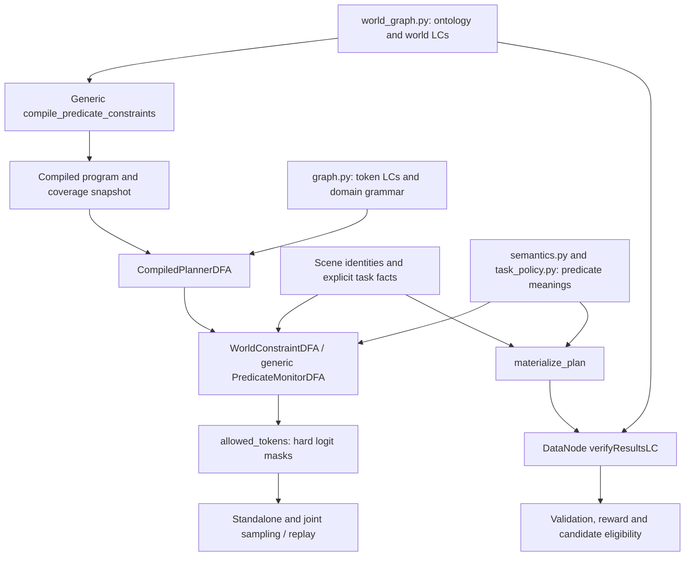

# DomiKnowS Logical Constraints in VLABench: Specification and Components

Source-aligned reference, updated 2026-10-17. This document describes the graph-constrained planner in `test_regr/VLABenchAgentInterface` and its integration with `test_regr/JointEmbodiedAgentInterface`. Native/raw generation is a separate evaluation mode and does not receive these decoding masks.

## 1. Current architecture

World logical constraints drive both incremental decoding and completed-plan verification. The generic compiler reads the actual logical expressions and registered predicate identities; constraint names are diagnostic labels. VLABench supplies the predicate meanings, token adapter, and request facts.



The compilation and binding sequence is:

1. `create_planner_generation_graph` declares token-level LCs.
2. `compile_planner_dfa` intersects the token-constraint DFA with the domain grammar derived from skill signatures and complete subtask patterns. It also calls `compile_world_constraints` to attach the compiled world program.
3. `bind_vlabench_contextual_dfa` binds scene identities and task requirements to that program, producing `WorldConstraintDFA`.
4. Sampling masks logits with this bound policy. Replay retains the same policy and token budget.
5. `materialize_plan(..., policy=policy)` reuses the bound task requirements for completed-plan verification. Alternatively, callers can provide `task_context=...` or `task_name=...`.

An unbound `CompiledPlannerDFA` recognizes the grammar only. Context-free planner entry points reject an unbound program with active semantic rules. Supplying only the grammar is not semantic enforcement.

## 2. Complete default world-constraint inventory

`build_vlabench_world_graph` declares **41 active head constraints** by default: 15 existing named rules, eight grounded planning rules, and 18 generated skill-argument rules. Custom builders and `include_default_constraints=False` can change this inventory.

In the formulas below, `O(op)` means `operation(op)`, `T(e)` means `transition(e)`, and `S_s(op)` means the skill predicate for skill `s`. Predicate meanings are executable definitions, not additional quantified formulas silently inferred from their names.

| Constraint name | Declared implication | Grounded meaning |
|---|---|---|
| `operation_exactly_one_skill` | `O(op) -> valid_skill_type(op)` | The skill name is in the declared signature map. Materialization assigns one-hot skill facts; this LC itself is an implication, not an existential cardinality formula. |
| `operation_schema_is_valid` | `O(op) -> valid_operation(op)` | Required target arguments are present and valid, and forbidden target arguments are absent. |
| `operation_pointer_is_valid` | `O(op) -> valid_pointer(op)` | Every supplied entity/container pointer resolves in the current scene. |
| `transition_matches_subtask_pattern` | `T(e) -> allowed_transition(e)` | Materialization grounds this from full plan validation, including complete subtask-pattern membership. The token grammar independently enforces the declared pattern language. |
| `button_entity_requires_press_skill` | `targets_button(op) -> S_press(op)` | An operation referencing a button must use `press`. |
| `press_requires_button_target` **(new)** | `S_press(op) -> targets_button(op)` | A press must target a button. This is the converse of the preceding rule and adds a restriction. |
| `task_skill_sequence` **(new)** | `O(op) -> task_skill_allowed(op)` | At operation index `i`, the skill must equal the declared sequence's skill at `i`, when a sequence is specified. |
| `task_initial_target` **(new)** | `O(op) -> task_target_allowed(op)` | The first operation must reference the specified initial target when one is supplied. Later operations are not forced to reuse that target. |
| `task_sequence_completion` **(new)** | `O(op) -> task_sequence_complete(op)` | On the last operation, the completed operation count must equal the declared sequence length. Nonfinal operations receive a true completion fact. |
| `anti_self_placement` | `O(op) -> not is_self_placement(op)` | The placement destination cannot equal the subject, using the held entity when the operation omits an explicit subject. |
| `pick_excludes_static_fixtures` | `O(op) -> not targets_static_fixture(op)` | A pick cannot target a recognized static fixture. |
| `no_redundant_repeated_picks` | `T(e) -> not repeated_pick_entity(e)` | A second pick of any previously picked resolved entity is forbidden throughout the current plan, including intervening place, pour, pull, or open operations. This is a plan-diversity policy; deactivate this LC for a domain that intentionally permits regrasping. |
| `container_destination_consistency` | `T(e) -> not inconsistent_container(e)` | A container operation must match the explicit object-specific destination, or the global `task_target_container` fallback. Different objects can have different destinations; an earlier placement does not invent a destination requirement. |
| `open_before_enclosed_placement` | `T(e) -> not unopened_container_placement(e)` | `place`, `pour`, or `insert` into a recognized enclosed container requires that container or its named door/lid to have been opened. |
| `composite_subgoal_completion` | `O(op) -> not premature_composite_eos(op)` | The last operation must meet the selected composite task's minimum operation count and required-skill set. |
| `skill_argument__{name}__{key}` | `S_name(op) -> flag_key(op)` or `S_name(op) -> not flag_key(op)` | Two rules per skill declare presence or absence of the two supported target argument roles. |

The four new declarations are:

```python
ifL(skills["press"]("op"), targets_button("op"), name="press_requires_button_target")
ifL(operation("op"), task_skill_allowed("op"), name="task_skill_sequence")
ifL(operation("op"), task_target_allowed("op"), name="task_initial_target")
ifL(operation("op"), task_sequence_complete("op"), name="task_sequence_completion")
```

### Grounded planning rules in both domains

All eight rules are actual LCs compiled by the shared predicate compiler. For each family `F`, the declaration is:

```python
ifL(andL(parent("x"), applicable_F("x")), satisfied_F("x"), name="grounded__" + F)
```

`parent` is the operation concept, except that `goal_completion` uses the episode/plan root. Applicability requires a relevant operation and at least one decidable check. Unknown checks are disclosed; they are never supplied as evidence of satisfaction. A known false check remains false even when another check in the same family is unknown.

| Family / LC suffix | Requirements and enforcement |
|---|---|
| `destination` | Resolve the manipulated object's declared destination, falling back to the global destination. Compare it with the current destination. |
| `holding` | Check the selected hand's held source before placement, insertion, pouring, release, or another adapter-declared manipulation. Preserve EAI's supported idempotent placement/release cases. |
| `capacity` | A grasp must fit the selected hand's declared capacity. Capacity zero rejects even when occupancy is unknown. These adapters represent one object per hand and accept capacities 0 or 1; unsupported capacities fail input validation. |
| `affordance` | Enforce known graspable, openable and pourable capabilities, and known access preconditions. Unknown capability/access facts remain unavailable. |
| `compatibility` | Enforce explicit object/receptacle compatibility and, for actions requiring containment, a known container capability. |
| `milestone_order` | Match declared action/subject/destination patterns and require predecessor milestones in the source state. Record progress only after predecessors have occurred. |
| `goal_completion` | At EOS and final acceptance, evaluate positive/negative symbolic goals and all required milestones. Known false goals reject completion. Unknown goals are disclosed and do not authorize an empty plan. |
| `preservation` | After effects, check protected entities and positive/negative state invariants. |

Joint EAI enables **62 default head LCs**: 54 existing action preconditions plus these eight rules. The standalone EAI graph builder retains its existing opt-in default (`include_default_constraints=True` enables them); the joint builder enables defaults in both domains. EAI uses a fresh request-bound `PredicateMonitorDFA`, without a context-identity policy cache or handwritten action masks. Domain-specific concept names prevent activation collisions across the joint graph.

### 2.1 Skill signatures

The authoritative signatures are `SKILL_ARGUMENTS` in `world_graph.py`:

| Skill | Required target argument | Forbidden target argument(s) |
|---|---|---|
| `pick` | `target_entity_name` | `target_container_name` |
| `place` | `target_container_name` | `target_entity_name` |
| `insert` | `target_container_name` | `target_entity_name` |
| `pour` | `target_container_name` | `target_entity_name` |
| `open_door` | `target_entity_name` | `target_container_name` |
| `press` | `target_entity_name` | `target_container_name` |
| `push`, `pull`, `lift` | None | Both target arguments |

In particular, `place` and `pour` do not require both a subject and a container argument. The semantic state tracks the held subject across operations.

### 2.2 Shared predicate meanings and state

`semantics.py` owns `PlanSemantics`, `OperationPredicates`, and immutable `PlanSemanticState`. Both materialization and the decoding adapter evaluate an operation against the state before advancing it.

State includes the held entity, opened entity names, first destination, previous skill/entity, immutable visited-pick set, completed operation count, and completed skill set. Pick history contains actions actually observed in the current plan; an initially held object does not invent a previous pick or completed milestones. Picking updates the held entity; placing or inserting releases it; pouring retains it. Opening a door records the opened entity without releasing the held object.

Grounding currently uses explicit name-based classifiers: button names contain `button`; static fixture names contain markers such as `table`, `counter`, `wall`, or `floor`; enclosed-container names match the declared keyword list. These are predicate definitions, not decoder-side enforcement wrappers, and do not constitute a complete physical model. Opening `cooler_a` or its named door/lid does not open `cooler_b`.

The transition-domain rules are evaluated on edges after the first operation. The domain grammar supplies the allowed complete subtask sequences; the world LCs do not replace that grammar.

## 3. Declarative task facts

`task_policy.py` holds `TaskRequirements`, the composite task declarations, and task-fact resolution. `world_graph.py` retains the primitive task contracts and canonical skill sequences.

| Request field | Interpretation |
|---|---|
| `task` or `task_name` | Selects a known primitive sequence or composite schema. |
| `episode_id` | Supplies the task through the existing planning-metadata parser when no task name is present. |
| `task_skill_sequence` | Supplies an explicit sequence of known skills, overriding the primitive sequence lookup. |
| `task_target_entity` | Supplies the initial target as a scene name or pointer. |
| `entities` or `entity_table` | Supplies observation-local identities, including explicit sparse integer mappings. |

Unknown tasks add no implicit task goal. Invalid explicit sequences and targets absent from the scene raise errors during binding. Without corresponding requirements, the task predicates impose no additional restriction. Composite completion remains a separate LC over the selected schema's minimum count and required skills.

For example, with a standalone runtime:

```python
context = {
    "entities": ("apple", "bowl", "button0"),
    "task_skill_sequence": ("pick", "place"),
    "task_target_entity": "apple",
}
policy = runtime.dfa_for("vlabench", context)

root = materialize_plan(
    plan, context["entities"], runtime.world_bundle, policy=policy,
)
evaluation = verify_plan_constraints(root, runtime.world_bundle)
```

A button's presence does not force the whole plan into `press -> button -> EOS`. Known density, friction, magnetism, reflection, sound-speed, and thermal-expansion QA task identifiers (including episode metadata) select a press sequence through `QA_TASK_PATTERNS`; these planning-only aliases do not add controller primitives or change checkpoint token/schema checksums. Instruction keywords alone do not choose an answer button. Explicit target facts or grounded numeric selection requirements can constrain the option.

Deactivating a task LC removes that rule's contribution after recompilation, without editing the decoder. Other active LCs and the grammar can still reject a sequence. Compiled policies are snapshots: graph edits require recompilation and a new binding; an existing collected policy retains its original program.

### 3.0 QA eligibility and plan diversity

`no_redundant_repeated_picks` now reads the whole-plan `visited_picks` set rather than only the previous action. Named and numeric pointers are resolved before comparison, so `pick obj:0 -> place bowl -> pick apple` is rejected when pointer 0 denotes apple. Distinct objects remain selectable. The LC, rather than a handwritten token mask, controls both completed-plan verification and decoding; deactivation permits intentional revisits, and compiled programs retain their original activation snapshot.

All six QA aliases require `press` through the existing `task_skill_sequence` and `task_sequence_completion` LCs. They remain separate from the ten controller primitive contracts so existing checkpoint vocabularies retain their token IDs and schema checksums. This fixes action shape without hardcoding an answer index.

Generic `SelectionRequirement` in `domiknows/generation/grounded.py` evaluates explicit `planning_facts.selections`. It supports `min`, `max`, `below`, `above`, and `rank` over finite supplied scores, targeting an operation's subject or destination. `rank` is a zero-based ascending order statistic, counting candidates including ties: with scores `[1, 1, 3]`, ranks 0 and 1 both admit either candidate scored 1. Min/max ties admit every tied optimum. Rank values must be integers within the explicitly declared candidate universe; known values that make the requested rank impossible reject a candidate even when other scores are missing. Threshold criteria require an exposed threshold. Observations must refer to declared scene candidates and use a common property/unit; Boolean, nonfinite, contradictory alias, and unresolved-entity inputs are rejected.

The complete candidate universe must be declared explicitly; score keys alone do not establish it. Missing scores can be omitted or set to `None`. Evaluation aggregates per-check grounding statuses in `detailed_metrics.grounding_coverage`, including `selection` checked/unavailable/partial/violated counts, so missing observations remain visible in the benchmark JSON.

```python
context = {
    "task": "density_qa",
    "entities": ("button2", "button0", "button1"),
    "planning_facts": {
        "selections": [{
            "action": "press",
            "property": "density",  # measured density for each explicitly bound option
            "criterion": "max",
            "candidates": ["button2", "button0", "button1"],
            "scores": {"button2": 1.0, "button0": 9.0, "button1": 4.0},
        }],
    },
}
# The admissible target is button0 (pointer 1), based on observations, not its label.
```

A friction question can similarly supply `property="observed_slide_time"`, `criterion="min"`, and observed option times. Floating can use `criterion="below"` with measured object densities and an explicit fluid-density threshold. The generic evaluator does not infer slide speed from shape names, assume button order encodes density, or read reference plans, hidden success conditions, or prepared reference state. The planning loader accepts explicit `planning_facts` annotations and supplies the scene-metadata adapter described below. Explicit press-selection annotations take precedence over automatic metadata models.

Eligibility is an action-target precondition enforced by the existing `grounded__affordance` LC in VLABench and EAI. Detailed `selection` diagnostic rows explain its grounding; they are not extra head LCs. Known losing options remain forbidden even when another option's score is missing. An unproven winner remains unavailable/partial. QA requests without observations get an explicit unavailable selection check, while their press sequence is still enforced. The default head counts therefore remain 41 (VLABench) and 62 (joint EAI).

The first chosen receptacle is not restored as a universal destination requirement. The accepted design permits task/object-specific destinations; use `task_target_container` or `planning_facts.destinations` when the task declares them. Changing this globally would incorrectly reject legitimate plans with different destinations. Distinct-object diversity alone also does not identify the correct ingredients: those targets require exposed task facts or the planner's grounded prediction.

Validation: 196 focused generic/standalone/EAI/joint checks passed; an additional 44-test QA, semantic, decoding/replay, and reachability run passed. The broader generation suite passed 634 tests with the existing trace-log-path failure described in section 4.4. Reproduce the new requirements with `.venv/Scripts/python.exe -m pytest test_regr/generation/test_selection_requirements.py test_regr/VLABenchAgentInterface/test/test_qa_and_pick_history.py test_regr/EmbodiedAgentInterface/test/test_grounded_constraints.py -q`. A fresh 450-episode checkpoint run is required to measure benchmark changes; neither restoring 75.13 macro nor 100% PhysLaw is implied by these local tests.

### 3.1 Optional `planning_facts` input

Supply observations and task requirements directly in request contexts or dataset examples. VLABench reads the explicit annotation from the environment config; EAI preserves it from the input row. Reference plans, reference-derived prepared EAI state, and hidden benchmark success conditions never initialize decoder facts.

```python
context = {
    "entities": ("apple", "cup", "bowl", "cooler"),
    "task_target_container": "bowl",  # optional global fallback
    "planning_facts": {
        "initial_state": {
            "positive": [["open", "cooler"]],
            "negative": [],
            "held": {"right": "apple", "left": None},
            "milestones": [],
        },
        "capacities": {"right": 1, "left": 1},
        "entity_properties": {
            "apple": {"graspable": True},
            "cup": {"graspable": True, "pourable": True},
            "bowl": {"container": True},
            "cooler": {"container": True, "openable": True},
        },
        "destinations": {"apple": "bowl", "cup": "cooler"},
        "compatibility": [{"subject": "apple", "destination": "bowl", "allowed": True}],
        "goals": {"positive": [["at", "apple", "bowl"]], "negative": []},
        "preserve": {"positive": [["open", "cooler"]], "negative": []},
        "protected_entities": [],
        "milestones": [],
        "completed_skill_prefix": [],
    },
}
```

Names (or VLABench scene pointers) must resolve in the current entity universe. Contradictory signed facts, invalid effect placeholders, duplicate/conflicting compatibility entries, and cyclic or unresolved milestone dependencies raise errors. A missing hand entry means unknown occupancy; `"right": None` means known empty. Missing `open` is unknown, not evidence of closure. The adapters normalize explicitly observed open/closed opposites.

The immutable `FactState`, `GroundedState`, `Operation`, `PlanningFacts`, checks and reports live in `domiknows/generation/grounded.py`. The generic layer has no benchmark action names or entity classifiers. It evaluates source preconditions, applies declared effects, then checks preservation and completion. Unspecified effects do not create observations.

VLABench effects preserve its held-object semantics: picking holds the source, pouring retains it, placement/insertion release it, and opening a door does not release an object. Symbolic placement uses `at(subject,destination)`, insertion uses `inside`, pouring uses `poured_into`, and holding uses `held(hand,object)`. EAI reuses pure parser/transition helpers with separate left/right hands and its own relations (`inside`, `ontop`, `holds_lh`, `holds_rh`, etc.). Its observed-effect helper receives no goal/reference facts and does not manufacture placeholder objects for unknown sources.

Explicit effect declarations refine adapter effects, for example:

```python
planning_facts["effects"] = {
    "open_door": {
        "positive": [["open", "$subject"]],
        "negative": [],
        "release_hands": ["right"],  # only when explicitly justified by this task
    }
}
```

Allowed placeholders are `$subject`, `$destination`, and `$hand`. Functional spatial updates refute alternative required locations for the same object, so a known wrong destination cannot leave its declared goal merely unknown.

### 3.2 Continuations, milestones, and no-op completion

An explicitly held object permits the corresponding VLABench subtask suffix without claiming that arbitrary prior milestones occurred. `task_skill_sequence=("place",)` can explicitly request an initially held object's placement. `completed_skill_prefix=("pick",)` records supplied task progress and offsets full-sequence checks; it must be a valid declared prefix and agree with held-state observations when required. Explicit completed milestones use `initial_state.milestones` and must name declared milestones.

A milestone declaration such as `{"name": "placed", "action": "place", "subject": "apple", "destination": "bowl", "requires": ["opened"], "required": True}` constrains matching operations. Declare `opened` separately, using the domain's action name (`open_door` in VLABench, `open` in EAI). Holding an object does not mark `opened` complete.

The request grammar and final schema validator accept the same grounded suffixes. EOS-only completion requires all declared goals and required milestones to be known satisfied, with no remaining sequence or composite obligation. Unknown goals or merely holding an object cannot authorize a no-op.

### 3.3 Grounding diagnostics

Reports contain per-family `checked`, `unavailable`, `partial`, `violated`, and `not_applicable` statuses, missing observations, a known-violation count, and `fully_grounded`. Partial grounding never hides a known violation. The report is available from materialized root attributes, constraint evaluation, VLABench agent decisions/reward breakdowns, EAI reward metrics, and structured candidates. `fully_grounded` describes the evaluated symbolic checks, not geometry, controller feasibility, or simulator success.

Grounded no-op plans stop the agent before controller execution; simulator success is still checked separately. Normalized facts and compiled policies are retained through generation and replay; joint EAI replay retains each collected policy. Rewards and candidate verification can consume the same policy. Existing action plans require no new annotations when observations are unavailable; coverage is reported instead of claiming full physical verification. EOS-only completion follows the stricter grounded-goal rule above.

## 4. Compilation, lifecycle, and strict decoding

### 4.1 Generic and domain-specific responsibilities

| Layer | Responsibility |
|---|---|
| `domiknows/generation/dfa/predicate_monitor.py` | Generic unary Boolean LC compilation, coverage, event evaluation, binding guards, and grammar/monitor composition. |
| `domiknows/generation/grounded.py` | Immutable signed facts, open-world checks, effects, progress and preservation; shared by both adapters. |
| `EmbodiedAgentInterface/utils/constraint_compiler.py` | EAI action parsing, hand semantics, explicit-fact binding and predicate registration. |
| `domiknows/generation/dfa/productive.py` | Generic exact bounded reachability and a productivity view over fully composed policies. |
| `VLABenchAgentInterface/constraint_compiler.py` | Predicate registration and the VLABench token/event adapter. `WorldConstraintDFA` subclasses the generic monitor. |
| `VLABenchAgentInterface/semantics.py` | Grounding and physical-prefix predicate meanings. |
| `VLABenchAgentInterface/task_policy.py` | Task declarations and executable task-predicate meanings. |
| `VLABenchAgentInterface/graph.py` | Vocabulary, token LCs, domain grammar, compilation entry point, and request binding. |

The generic predicate compiler supports Boolean connectives (`ifL`, `notL`, `andL`, `orL`, `nandL`, `norL`, `xorL`, `iffL`/`equivalenceL`), `forAllL`, and finite-grounded `atMostL`/`atLeastL`/`exactL`/`existsL` counts. Multiple named variables and direct relation arguments use explicit finite event domains and entity-keyed observations; existing single-variable planner events remain compatible. See `domiknows/generation/dfa/README.md` for grounding, local count scopes, and the evaluation limit. It snapshots active head constraints in the selected graph and descendant subgraphs. `program.coverage` records compiled and inactive head constraints.

Unsupported operators, unregistered predicates, arbitrary graph paths, and incompatible event domains/phases fail compilation with the constraint name. Missing domains or missing/non-Boolean observations raise `MissingSemanticBinding`; a grounding budget exhaustion raises `PredicateGroundingLimitExceeded`. The adapter supplies the correct event lifecycle and values, including finite domains when using additional variables; the compiler does not infer predicate meanings from names.

### 4.2 When predicates execute

| Event domain / phase | When emitted | Main rules |
|---|---|---|
| `operation / immediate` | After an operation's arguments are complete, or immediately for a zero-argument skill | Skill/schema/pointer, button applicability, self-placement, static fixtures, and argument signatures. |
| `transition / immediate` | After completing an operation with a predecessor | Pattern, repeated pick, destination consistency, and enclosed-container access. |
| `operation / task_skill` | When a skill token is consumed | Declared skill at the current operation index. |
| `operation / task_target` | When an operation is complete | Initial target requirement. |
| `operation / completion` | At EOS, when finalizing the previous operation before starting another, and during acceptance checks | Task sequence completion and composite completion. |

Nonfinal operations receive non-premature completion facts. EOS and final acceptance recheck the actual last operation's completion conditions. This avoids rejecting a valid prefix merely because its task is not complete yet.

### 4.3 Token graph and domain grammar

Two token LCs remain in `create_planner_generation_graph`:

1. **EOS closure:** if EOS occurs before another token, that later token must also be EOS. This prevents non-EOS continuation after termination; it does not itself bound repeated EOS padding.
2. **Non-EOS token budget:** `atMostAL(notL(EOS), max_operations * 5)` limits the number of non-EOS tokens. This is a token cap, not an independent count of completed operations.

The domain grammar separately enforces skill/argument token structure, complete declared subtask-pattern concatenations, the configured operation limit, and EOS at complete boundaries. Task restrictions do not replace syntactic parsing.

The former inactive `contextual_qa_button_press` token rule and its registration have been removed.

### 4.4 Reachability and stopping

Both planner implementations use `domiknows/generation/dfa/stop_policy.py`. Callers supply either `StopPolicy(...)` or the compatible `max_steps=N` argument, never both. The shared policy handles budgets, timeout, external cancellation, EOS/acceptance stops, and stagnation limits. Cancellation before acceptance raises an error instead of returning a partial plan.

`remaining_steps_for(policy, step_index)` returns the number of transitions available **after the candidate token**. Thus a final accepting token is permitted with `remaining_steps=0`; EOS consumes a transition.

With a finite budget, the semantic monitor masks a candidate unless an accepting completion remains reachable within that budget. Without a budget, its token filtering checks immediate semantic transitions. `ProductiveDFA` can wrap a fully composed policy to include additional outer restrictions in reachability.

Reachability uses an iterative exact search with a default cap of 10,000 state expansions per query. Exceeding the cap raises `SemanticSearchLimitExceeded`, meaning feasibility is unknown. It does not relax constraints or cache an approximate rejection as an exact answer. An empty allowed set is reported as failure rather than restoring forbidden tokens.

The shared search first spends at most 256 expansions (and at most one quarter of the configured cap) probing for a depth-first witness. If that probe remains inconclusive, breadth-first discovery avoids repeatedly unrolling cycles and starvation behind long branches. Proven witness lengths and exhausted budgets are reusable across token horizons; successor lists are cached only after complete enumeration. Both stages and every candidate token share the original per-query expansion cap.

`DFACompletionBounds` adds a generic admissible bound from an explicit finite relaxation. `PredicateConstraintProgram.project(...)` retains only entire compiled rules whose predicates are observable in the relaxed model; other rules remain in the full monitor. VLABench projects the operation grammar plus task skill/completion events, using the same predicate-meaning helpers as concrete decoding. Entity-dependent physical rules are omitted from this relaxation, not assumed satisfied in concrete decoding. Reverse shortest-path distances prove when a required-skill suffix is impossible, bound the remaining token cost, and guide witness search before entity combinations are enumerated. A finite distance alone never establishes concrete feasibility.

The structural bound cache is scoped to the compiled grammar and keyed by the projected LC snapshot, explicit skill sequence, completed progress, and schema requirements. A deactivated or newly added LC therefore changes pruning without search-code changes. Entity facts remain freshly bound per request, and entity identity or reference plans do not select cached physical answers. Requests without an explicit operation grammar retain ordinary exact search.

`test_planning_search_failures.py` includes 64-entity chemistry and hammer/picture counterexamples: without the bound, both exhaust the unchanged 10,000-expansion limit; with the bound, the same prefixes are proved infeasible without enumerating their entity combinations. Separate positive cases check valid completions and identical sampling/replay masks. These checks complement the bounded-language audits against completed-plan verification; they do not constitute a rerun of the 450-episode checkpoint benchmark.

Validation of this change: 207 focused compiler/planning/EAI/joint tests passed; the updated search-failure suite passed all 8 cases. The broader generation suite passed 618 tests with one existing failure in `test_decode_hmm_dfa_trace_logger_writes_step_stats` (expected log path versus repository-namespaced log path). Reproduce the wide-scene checks with `.venv/Scripts/python.exe -m pytest test_regr/VLABenchAgentInterface/test/test_planning_search_failures.py -q` and the generic search checks with `.venv/Scripts/python.exe -m pytest test_regr/generation/test_productive_reachability.py test_regr/generation/test_predicate_monitor.py -q`.

Planner evaluation retains failed generations in the score denominator and reports `generation_failures`, `semantic_search_limit_failures`, and `generation_errors` with episode identifiers and error messages. The joint evaluation JSON exposes both counts at the top level and prints them in the scorecard. An empty output caused by unknown reachability must therefore be distinguished from a successfully decoded plan. Search regression tests do not establish a replacement 450-episode checkpoint score; that requires rerunning the checkpoint evaluation.

Replay uses the same bound policy, finite-budget masks, token termination rules, and stagnation checks. It does not rerun collection wall-clock timeouts or external cancellation callbacks while computing gradients.

## 5. Component consumption and enforcement

| Component | How it consumes constraints |
|---|---|
| `world_graph.py` | Declares LCs, materializes deterministic DataNodes, and aggregates active head-constraint results from `verifyResultsLC(key="/local/argmax")`. Default aggregation is minimum satisfaction. Inactive heads are excluded; no active heads returns `None`. |
| `graph.py` and `constraint_compiler.py` | Compile the token grammar and actual world formulas, then bind scene/task facts to the generic monitor. |
| Standalone and joint `models.py` | Query `allowed_tokens`, mask disallowed logits to negative infinity, advance with `step`, and require accepting termination. Replay evaluates sampled labels under the same masks. |
| `VLABenchAgentInterface/simulation/program.py` | Binds online task/target facts, retains the resulting policy in replay evidence, and checks schema, DFA acceptance, and world satisfaction before execution. `_task_pattern_dfa` remains a compatibility helper that binds facts to LCs; it contains no separate token-filtering implementation. |
| `VLABenchAgentInterface/simulation/agent.py` | Accepts optional `task_context`, validates generated plans with the bound DFA and completed-plan verification, and stops rollout when a plan is invalid. |
| `VLABenchAgentInterface/reward.py` | `score_vlabench_plan` gates its planner reward on schema and world validity. A verification failure or score below 1.0 makes the plan invalid and sets this reward to zero. Simulator rollout returns also depend on environment progress/success; they are not simply this plan score. |
| `JointEmbodiedAgentInterface/structured_inference.py` | Generates complete constrained candidates, verifies them using the bound policy's task requirements, and selects among eligible candidates. |
| `JointEmbodiedAgentInterface/world_graph.py` | Builds the domain runtimes and binds VLABench facts per request. Scene-dependent VLABench policies are not cached by entity count or context-object identity. |
| `training.py` and `JointEmbodiedAgentInterface/eval_planning.py` | Use the bound planning policy and report planning metrics plus validity/reward diagnostics. |

### 5.1 ILP selection is candidate selection

For VLABench, eligibility is `dfa_valid and schema_valid and constraint_valid`. The ILP chooses one eligible candidate maximizing its autoregressive log probability. It does not translate every world LC into a new global planning ILP or repair an arbitrary invalid plan.

If Gurobi is unavailable, selection falls back to the highest-scoring eligible candidate. If none is eligible, the result reports `infeasible` and retains an invalid candidate for reporting; it must not be interpreted as a valid solution. No fixed solver-latency guarantee is asserted here.

### 5.2 Official metrics and constraint validity

Official planning metrics such as SR, PR, SPR, PM, overall progress score, and macro averages are computed separately from world-constraint validity. A zeroed planner reward does not imply that every official metric is zeroed. Report validity and constraint satisfaction alongside those metrics; a planning progress score alone is not evidence that every constraint passed.

Native/raw evaluation omits the graph decoder and semantic token masks. Its results must be distinguished from graph-constrained inference.

## 6. Removed duplicate enforcement

The following mechanisms no longer implement plan restrictions:

- `VLABenchContextualDFA`, `VLABenchCausalDFA`, and `VLABenchCompositePlanningDFA`.
- The handwritten `_TaskPatternDFA` and `_EntityPointerDFA` classes, and the count-only `_entity_pointer_dfa` helper.
- `_resolve_physical_law_button` and its density/friction answer-selection heuristics.
- `_press_button_fallback_plan` and automatic substitution of a button plan.
- The environment-module check that silently changed the `select_book` sequence for synthetic fixtures. Such fixtures now supply an explicit `task_skill_sequence`.

Physical predicate evaluation, token parsing, and controller execution remain executable code. Plan-permission decisions use the logical declarations; they are not reimplemented by those removed wrappers.

## 7. Validation and reproducible checks

New grounded suites cover all eight families, per-object destinations, initial holding/open state, continuations, satisfied-goal completion, unknown diagnostics, reference isolation, hand separation, negative goals, and bounded acceptance/mask comparisons. Both domain suites isolate and deactivate each LC to prove that enforcement comes from the graph. The VLABench suite also adds replacement LCs without decoder edits. Sampling/replay tests include explicitly grounded requests.

Current grounded implementation: **227 focused tests passed** across the shared compiler/state/stop policy, VLABench semantics/graph/reward/task/replay/equivalence, EAI grounding/world/reward, and joint pipeline suites. The broader three-interface run recorded **469 passed, 13 failed, and 1 skipped**. The failing tests concern assistance execution, native CLI output, and existing controller/CLI contracts; all 13 reproduced against the pre-change source snapshot with the same failing assertions. No new broader-suite failures were identified. Subsequent targeted runs passed 73 tests (EAI/shared state/joint) 56 tests (VLABench grounding/replay/shared state), and 59 tests (final shared state and domain semantics/grounding).

Before this grounded extension, validation recorded **159 passing focused tests** across the world graph, compiler, shared predicates, task policies, bounded equivalence, decoding integration, stop policy, and joint planner suites. A broader pipeline/joint run recorded **143 passed, 10 failed, and 1 skipped**. All ten failures reproduced with the pre-change implementations and concern controller APIs or a CLI default. These are local regression results, not a new GPU planning benchmark or simulator deployment result.

Key test coverage:

| Test module | Evidence |
|---|---|
| `test_regr/generation/test_grounded_planning.py` | Immutable signed state, all eight checks, contradictions, effects, unknown values and protected changes. |
| Both domains’ `test_grounded_constraints.py` | Grounded counterexamples, continuations, hand-specific behavior, each LC’s contribution, and exact-budget masks against bounded independent oracles. |
| `test_semantics.py` | Pointer aliases, held-object state, container identity, schema predicates, and cross-operation grounding. |
| `test_constraint_compiler.py` | Formula-driven masking, unsupported-shape failures, rule activation, causal examples, and EOS completion. |
| `test_constraint_equivalence.py` | Exhaustive small-scene grammar paths versus completed-plan verification, exact-budget token masks, independent semantic counterexamples, and rule deactivation/addition. |
| `test_task_policy.py` | Explicit task/target facts, absence of implicit button goals and answer guessing, task-rule deactivation, metadata grounding, and bounded task-language equivalence. |
| `test_decoding_integration.py` | Actual model-side masks, sampling/replay log-probability agreement, live-agent task facts, strict acceptance, and cancellation behavior without downloading a VLM. |
| `test_regr/generation/test_predicate_monitor.py` | Generic compilation and monitoring in a document workflow, including noninteger symbols and independent Boolean truth tables. |
| `test_regr/generation/test_stop_policy.py` | Shared budget conventions and final-token boundaries across DFA views. |
| `test_regr/JointEmbodiedAgentInterface/test/test_joint_pipeline.py` | Joint runtime binding, scene changes, domain facades, and differentiable replay. |

`test_regr/generation/constraint_equivalence.py` is the reusable audit harness. It enumerates syntax using `step`, not semantic masking, so rejected counterexamples cannot disappear from the comparison. It compares complete acceptance and next-token masks at every budget within the finite horizon. Terminal symbols stop enumeration. These tests establish agreement for the enumerated scenes and bounds, not an unbounded equivalence theorem or general physical feasibility.

From the repository root on Windows, the focused checks can be reproduced with:

```powershell
.\.venv\Scripts\python.exe -m pytest `
  test_regr/generation/test_grounded_planning.py `
  test_regr/VLABenchAgentInterface/test/test_grounded_constraints.py `
  test_regr/EmbodiedAgentInterface/test/test_grounded_constraints.py `
  test_regr/EmbodiedAgentInterface/test/test_world_graph.py `
  test_regr/EmbodiedAgentInterface/test/test_reward.py `
  test_regr/VLABenchAgentInterface/test/test_task_policy.py `
  test_regr/VLABenchAgentInterface/test/test_constraint_equivalence.py `
  test_regr/VLABenchAgentInterface/test/test_constraint_compiler.py `
  test_regr/VLABenchAgentInterface/test/test_semantics.py `
  test_regr/VLABenchAgentInterface/test/test_graph.py `
  test_regr/VLABenchAgentInterface/test/test_reward.py `
  test_regr/VLABenchAgentInterface/test/test_decoding_integration.py `
  test_regr/generation/test_predicate_monitor.py `
  test_regr/generation/test_stop_policy.py `
  test_regr/JointEmbodiedAgentInterface/test/test_joint_pipeline.py -q --tb=short
```

Test counts may grow as cases are added. Historical checkpoint scores, remote host paths, and timings from the previous document are not evidence that the current constraint semantics were deployed or benchmarked. Rerun planning evaluation against the intended checkpoint and configuration before reporting current benchmark results.

The broader command was:

```powershell
.\.venv\Scripts\python.exe -m pytest test_regr/VLABenchAgentInterface test_regr/EmbodiedAgentInterface test_regr/JointEmbodiedAgentInterface/test/test_joint_pipeline.py test_regr/generation/test_predicate_monitor.py test_regr/generation/test_stop_policy.py test_regr/generation/test_grounded_planning.py -q --tb=short
```

Baseline comparison used the pre-change source snapshot at `C:/Users/auszok/AppData/Local/Temp/grounded-planning-baseline-fvijmwzk`, with the 13 failing test nodes replayed against those interface modules. Results: two existing assistance assertions, one native CLI JSON-output assertion, one CLI rollout-default assertion, and nine controller API/numerical assertions reproduced. A surviving existing Python docstring escape warning and baseline `atMostAL` deprecation warnings are separate from semantic acceptance results.


## Density QA dataset correction (2026-10-18)

The offline migration `repair_density_labels.py` fixes the upstream density
config manager to select the button associated with the chosen material,
rather than treating density rank as button position. Saved answers are
recomputed independently from input instructions, scene materials and positions,
and VLABench's qualitative material ordering. Only after this selection does the
migration inspect old labels to validate their encoding and update the saved
press operation and success condition together. No label or success condition is
added to decoder grounding, and no new logical constraint is introduced.

On gpu2, repair revision `density-material-button-v1` corrected 74/100 density
episodes, including 9/11 density test episodes. All 100 then passed the audit;
images and instructions were unchanged. The material ordering is a benchmark
model, not a measurement of physical density. Existing scorecards were not
modified or reevaluated. Historical comparisons require the same repaired label
revision and dimension mapping for every run. See the README's density repair
section for the audit/apply commands and backup semantics.


### Scene-metadata physics grounding (steps 1–3)

In `metadata-assisted` mode, `physics_grounding.py` converts input instructions and scene components into
`planning_facts.selections`. It receives no output plan or success conditions.
Nested button/object relationships are used directly; flattened components use
unique nearest planar associations within 0.25 scene units, with a 2x distance
margin. Missing, duplicate, or ambiguous associations remain unknown. Candidate
button IDs and component order never encode a preferred answer.

The adapter declares qualitative ordinal models separately from measured values:

| Task | Property model | Comparisons |
|---|---|---|
| Density | wood < rubber < water < glass < stone < metal | min, max, middle rank, below water |
| Sound speed | rubber < water < wood < stone < glass < metal | min, max, middle rank |
| Thermal expansion | glass < wood < stone < metal < rubber | least, most, middle rank; benchmark heat/cool model |
| Magnetism | benchmark metal=1, known other materials=0 | magnetic=max, non-magnetic=min |
| Friction | benchmark slide cost sphere=0, cylinder=1, box=2 | fastest=min, slowest=max, second-fastest rank=1 |
| Reflection | explicitly bound reflectance fractions from saved metadata or an input observation file | min, max, middle rank; missing observations stay unknown |

These are public VLABench model abstractions, not universal physical laws or
measured coefficients. Unrecognized materials/shapes and unsupported comparisons
remain unavailable. Reflection image estimation is not implemented. Reflectance export and explicit
observation ingestion are described below. Existing annotated measurements override automatic models.

Dataset examples and reward items expose `planning_observation_profile`.
Automatically adapted QA examples use `scene_metadata_physics_v1`; explicit
press-selection annotations use `declared_planning_facts`. Evaluation aggregates
these in `detailed_metrics.observation_profiles`. This makes the metadata-assisted
input contract distinguishable from an image-only experiment. No new head LC or
decoder-specific mask was added: task shape uses the existing sequence LCs and
selection eligibility uses `grounded__affordance`. The generic rank comparison
also works for EAI without changing hand semantics.

Example of a reusable rank requirement (middle candidate among three):

```python
planning_facts = {"selections": [{
    "action": "press", "argument": "subject",
    "property": "density_qa:qualitative_model_v1",
    "candidates": ["button2", "button0", "button1"],
    "scores": {"button2": 0, "button0": 4, "button1": 5},
    "criterion": "rank", "rank": 1,
}]}
```

A read-only CPU audit of the repaired gpu2 seed-42 test split grounded 46/60
PhysLaw episodes: density 11, friction 5, magnetism 11, sound speed 6, thermal
expansion 13. All 46 agreed with references after predictions were derived from
scene inputs; reflection's 14 episodes retained unavailable scores. This is an
input/label consistency check, not a new GPU checkpoint score. Focused runs
passed 167 generic/QA tests and 186 integration/EAI/joint/metric tests (overlapping
suites). They include independent order-statistic enumeration with ties,
unknown-score violations, shuffled options, gold-label isolation, LC deactivation,
fresh request binding, and sampling/replay log-probability agreement.

Reproduce the key new checks with:

```bash
python -m pytest test_regr/generation/test_selection_requirements.py \
  test_regr/VLABenchAgentInterface/test/test_physics_grounding.py \
  test_regr/VLABenchAgentInterface/test/test_qa_and_pick_history.py \
  test_regr/VLABenchAgentInterface/test/test_decoding_integration.py \
  test_regr/EmbodiedAgentInterface/test/test_grounded_constraints.py -q
```

Broader validation for these steps: `python -m pytest test_regr/generation test_regr/VLABenchAgentInterface -q` recorded **1166 passed, 14 failed, 1 skipped**. All 14 failing nodes reproduced against the pre-change commit `cb6ed026` in an isolated source snapshot. They concern the trace-log path, two assistance assertions, native CLI stdout, a rollout default, and nine controller API/numerical assertions. No new broader-suite failure was found. Two follow-up observation-profile propagation assertions also passed.


### Reflection: explicit observations and missing-data reporting

The old `Mirrors` entity inherited `Entity.save()`, which saves pose and class
but omits reflectance. The reflection generator also discarded the explicit
button-to-mirror bindings from its exported scene. The upstream source notes a
MuJoCo reflection rendering limitation; image brightness is not treated as a
calibrated reflectance observation.

`utils/preserve_reflection_observations.py` patches the upstream generator to attach
`option_buttons` alongside its shuffled reflectance vector. `Mirrors.save()`
then preserves those bindings and the numeric MJCF material reflectance values.
These are simulator material metadata, not an image-derived estimate. The
adapter requires both arrays; a reflectance vector alone never implies that
array position corresponds to a button number. Nested and flattened Mirrors
components are supported. Existing unbound snapshots are not relabeled.

For existing episodes, independently obtained observations can be supplied in
`input/property_observations.json`:

```json
{
  "version": 1,
  "source": "reflectometer",
  "observations": [
    {"entity": "button2", "property": "reflectance", "unit": "fraction", "value": 0.55},
    {"entity": "button0", "property": "reflectance", "unit": "fraction", "value": 0.90},
    {"entity": "button1", "property": "reflectance", "unit": "fraction", "value": 0.20}
  ]
}
```

The generic immutable `PropertyObservations` parser validates schema version,
source, explicit entity references, duplicate records, units, and finite numeric
values. The reflection adapter additionally enforces fractions in [0, 1]. Null
or omitted candidate values remain unknown. Conflicting supplied and saved
values are rejected; observations cannot silently overwrite one another.
Explicit `planning_facts.selections` retain their existing precedence in metadata-assisted mode.

Metadata-assisted reflection requests use `reflection_observations_v1` when an observation source
is supplied and `reflection_unavailable_v1` otherwise. Property availability is
reported separately as `observed`, `partial`, or `unavailable`, including missing
candidate names, source names, and reasons such as an omitted reflectance field
or missing `option_buttons` binding. This report travels in
`planning_facts.observation_report` and appears with episode IDs in
`detailed_metrics.observation_reports`. Selection checks still disclose unknown
scores and reject known losing candidates through the existing LCs, even with
partial observations. Property availability does not assert full physical
verification or simulator success.

Dry-run and apply commands for a VLABench installation:

```bash
python -m test_regr.VLABenchAgentInterface.utils.preserve_reflection_observations \
  --upstream-root /opt/dominows/VLABench
# To apply, append --apply --backup-dir /path/outside/source/new-backup-directory
```

On gpu2, exporter revision `reflection-observation-export-v1` patched the two
upstream source files, with originals, hashes and diffs backed up at
`/home/auszok/reflection_observation_exports/20261018T161826Z`. All 500 files in
the existing 100-episode reflection collection retained their hashes. All 100
snapshots lack the required export fields, including the 14 test episodes;
their missing values were not reconstructed from reference targets. Newly
loaded generators preserve the fields for future episodes.

Validation: 318 focused tests passed across numeric observations, rank selection,
reflection and other QA grounding, masks, completed-plan checks, replay,
metrics, EAI and joint integration. Actual upstream generator/build/save/reload
methods passed all 18 position/target combinations using pure dependency stubs;
real `dm_control.mjcf` material readback also passed. No simulator rollout or new
checkpoint benchmark was run. The earlier broader 1166-pass run and its 14
baseline-reproduced failures remain separate evidence for steps 1-3.

```bash
python -m pytest test_regr/generation/test_property_observations.py \
  test_regr/VLABenchAgentInterface/test/test_reflection_observations.py \
  test_regr/VLABenchAgentInterface/test/test_physics_grounding.py -q
```


### Default visual evaluation versus metadata-assisted verification

The default dataset and evaluation observation mode is now `visual`.
`load_planning_examples` and `load_scene_planning_examples` accept an explicit
`observation_mode`; standalone and joint evaluation CLIs expose the same
`--observation-mode {visual,metadata-assisted}` switch. Both the joint test-split
preparation path and the all-split loading path propagate the choice. Joint
reports and standalone CLI reports record the requested mode, while detailed
metrics count effective observation profiles.

In visual mode, all six QA task contracts still require `press` and a valid
button. The VLM chooses the button from its visual/context representation.
`visual_qa_v1` supplies no symbolic property scores. QA physical-property
annotations, saved reflectance, input property sidecars, goal/target annotations,
and reference-derived entity additions cannot restrict that choice. The loader
uses only scene entity identifiers for the QA entity table. The mode concerns
QA property selection; the existing scene/entity and structural task interfaces
remain part of the input contract.

Every prediction remains in SR/PR/SPR/PM and dimension denominators. The saved
reference answer is used for scoring after generation. `selection: unavailable`
and the observation report identify a lack of symbolic property verification,
not an unscorable episode or an automatic generation failure. In particular,
the original 14 reflection test episodes need no regeneration or numeric
reflectance recovery for standard reference-based benchmark evaluation.

Metadata-assisted mode explicitly enables the preceding material/shape models,
annotated selections and reflection observation sources. Its results must be
reported separately from visual property-choice results. Direct APIs that are
supplied explicit planning facts continue to enforce them; the dataset profile
controls which QA facts are admitted as inputs. Native frozen-VLM CLI evaluation
accepts visual mode only because it does not use the graph's property constraints.

Tests cover all 14 ungrounded reflection predictions being scored, independent
reference labels, all candidate buttons remaining available in visual mode,
metadata-assisted masks selecting the grounded option, ignored sidecars/targets,
reference-independent entity tables, standalone/joint CLI forwarding and report
provenance. A read-only audit of gpu2's actual dataset retained all 450 test
examples in both modes, including 60 PhysLaw and 14 reflection episodes. The first full visual GPU result is recorded in the following section.

Current mode validation: **326 focused tests passed**, including CLI forwarding for both modes, joint test/all split paths, raw reference scoring of all 14 reflection predictions, rank/observation parsing, reflection/other QA grounding, decoding/replay, EAI and joint integration. A separate native/decoding compatibility run recorded 95 passed and the previously baseline-reproduced native CLI stdout/JSON failure.

### Complex representation and planner adaptation (2026-10-18)

The first full visual-mode GPU run evaluated all 450 episodes, including all 60
PhysLaw and 14 reflection cases, with zero generation/search failures. Overall
was 72.7231, macro 70.9278, Complex 54.2039, and PhysLaw 56.0. All 60 PhysLaw
predictions selected button0. Forty of 56 Complex predictions reached the old
eight-operation limit; 17 book and seven chemistry references have nine
operations. These results motivate the following changes, rather than imply
that the new adaptation has already improved scores.

The operation default is now 12. The generic `BoundedPatternLanguage` in
`domiknows/generation/dfa/pattern_language.py` represents bounded concatenations
without enumerating all sentences. `StopPolicy`, productive token masks, strict
acceptance, and explicit search-limit errors remain in use. The token budget is
derived from the operation budget. Explicit smaller budgets remain supported.

`push` accepts an optional `target_container_name`. The world declares the role;
the vocabulary, codec, grammar, monitor, schema verifier, and completed-plan
validation all support it. Omitting it remains legal for existing movement
tasks. A targeted push declares the symbolic `pushed_to(subject,destination)`
effect, which does not prove simulator contact or successful nail insertion.
Controller skill IDs and motor contracts remain unchanged. Compact planning
contracts for `select_drink` and `select_toy` omit simulator lift movements only
when the request declares `planning_interface="compact"`.

`complex_grounding.py` supplies facts to the existing compiled selection,
destination, milestone-order, and goal-completion LCs:

| Task | Exposed grounding | Requirements |
|---|---|---|
| cook_dishes | Instruction-named recipe, public recipe catalog, visible ingredient and plate names | Required ingredients at the plate; eligible ingredient picks; matching destinations |
| book_rearrange | Visible book chronological keys, shelf, requested direction | Ordered pick/push milestones, every book targeted at the shelf, complete pick/push/pull cycles |
| take_chemistry_experiment | Explicit solution mentions, visible reagent vessels, flask and table | Required transfers and returns; pick/pour/place cycle; reusable reagent vessels; no amounts or extra transfers inferred |
| hammer_nail_and_hang_picture | Instruction-selected painting and unique visible hammer, nail and counter | Grasp tool, push nail with tool, return tool, grasp painting, push painting to nail |
| texas_holdem | Visible cards | Winning-hand grounding remains unavailable; no hidden winning-hand condition is imported |

Recipe source: `OpenMOSS/VLABench`,
`VLABench/configs/task_related/recipe.json`. Book ordering and tool-use contracts
come from its public composite task definitions. Ambiguous/missing input
grounding is reported, not replaced by a reference-derived answer. Scene entity
tables for every task now exclude condition traversal and reference-plan
additions. Numeric references remain labels for scoring, never decoder facts.

Generic `PlanningFacts` also supports action-specific destinations, for example:

```json
{"action_destinations": [
  {"action": "pour", "subject": "NaCl", "destination": "flask"},
  {"action": "place", "subject": "NaCl", "destination": "table"}
], "reusable_entities": ["NaCl"], "skill_cycle": ["pick", "pour", "place"]}
```

Action-specific requirements take precedence over object-wide/global
destinations. Repeated matching actions advance only milestones enabled in the
source state; a single action cannot complete its own successor milestone.
Declared reusable entities can be picked again without disabling the LC that
rejects redundant picks for other entities. Skill cycles and exact declared
sequences are evaluated through the existing task-skill/completion LCs.

The domain checksum changes. Exact checkpoint resume continues to reject drift.
Joint evaluation provides explicit `--allow-planning-schema-migration` for the
audited old schema: label meanings, EAI, model and controller compatibility must
still match; the operation budget cannot decrease. Planner optimizer state is
not restored during this warm start. New checkpoints use the current schema.

`--decision-trace path.jsonl` records unmasked logits, productive allowed tokens,
their probabilities and chosen token without changing decoding.
`--input-probe` supports entity permutations, missing/shuffled images, and
shuffled instructions. Non-original probes are diagnostics, not benchmark scores.
The prompt no longer guesses button/object bindings from entity-list adjacency.

`JointEmbodiedAgentInterface.finetune_planning` adapts the VLABench label head
with task-balanced sampling (75% Complex/PhysLaw), consistent entity/pointer
permutations, and double weight for pointer-token losses. It uses the existing
training split and selects checkpoints by generated full-validation macro score,
requiring retention of overall and every measured dimension score and generation
failure count. The original model is the fallback when no candidate qualifies.
The domain-independent retention predicate is in
`domiknows/generation/validation.py`. Teacher-forced validation loss remains a
diagnostic, not a promotion criterion. Qwen/LoRA, EAI
and controller parameters are frozen and checked by SHA256 at each epoch.
Epoch checkpoints include optimizer and sampler state for resumption; test
references never select the checkpoint. Visual and metadata-assisted evaluation
remain separate input contracts.

Reproducible checks:

```bash
python -m pytest -q test_regr/VLABenchAgentInterface/test/test_complex_improvements.py \
  test_regr/JointEmbodiedAgentInterface/test/test_planning_adaptation.py
python -m test_regr.VLABenchAgentInterface.utils.audit_planning \
  --planning-dir test_regr/VLABenchAgentInterface/data/planning --output audit.json
python -m test_regr.JointEmbodiedAgentInterface.utils.finetune_planning \
  --checkpoint test_regr/JointEmbodiedAgentInterface/checkpoints/joint_stage2_best.pt \
  --split validation --epochs 3 --samples-per-epoch 512 --output checkpoints/planning_adaptation
```

The read-only server audit passed all 4,500 reference plans with zero schema,
round-trip, budget, or bound-constraint issues. Tests independently enumerate a
bounded pattern language, check optional push decoding against completed-plan
verification, reject wrong book order and tool milestones, and cover pointer
permutations, trace observations, checkpoint migration and seeded balancing.
Controlled server runs compare representation-only, grounded visual,
metadata-assisted, and adapted-head conditions; measured results are recorded
with their run provenance rather than inferred from passing tests.

### Completed server comparisons (2026-10-18)

Every condition below evaluated the same corrected 450-episode test split,
with all six dimensions represented and zero generation/search-limit failures.
The original champion weights are retained as the recommended model.

| Condition | Overall | Macro | Complex | PhysLaw |
|---|---:|---:|---:|---:|
| Previous full visual run | 72.72 | 70.93 | 54.20 | 56.00 |
| Representation/input repairs, automatic Complex grounding disabled | 74.47 | 72.34 | 54.70 | 61.00 |
| Grounded Complex, visual QA | **78.54** | **77.78** | **87.35** | **61.00** |
| Grounded Complex, metadata-assisted QA | **82.67** | **82.95** | **87.35** | **92.00** |
| Experimental adapted head, visual QA (rejected) | 63.81 | 64.88 | 87.81 | 66.00 |
| Experimental adapted head, metadata-assisted QA (rejected) | 67.01 | 68.88 | 87.81 | 90.00 |

Visual mode here describes QA property choice within the scene/entity interface;
Complex grounding additionally uses exposed instructions and public task
knowledge. It is not a claim of raw-image-only planning. Metadata-assisted QA
uses additional property facts and remains a distinct input contract.
Visual QA answered 21/60 buttons correctly; metadata assistance answered 52/60.
All 14 reflection cases were scored; six were correct with the retained model.

The retained grounded visual model scored 100 on book rearrangement (17 cases),
cooking (11), and hammer/picture tasks (10); chemistry scored 90.95 (7).
Texas hold'em remains weak at 41.36 (11), with its winning-hand predicate
explicitly unavailable in the adapter. Relative to the previous visual run,
ComSense declined 1.90 and Spatial 2.55 points; M&T and Semantic improved.

The three-epoch head-only prototype sampled 512 training examples per epoch.
Its original loss-based selection chose epoch 0 (validation loss 2.4726), but
generated validation QA accuracy declined from 40.74% to 35.19% on all 54
validation PhysLaw episodes. It was not promoted, before considering test
performance. This observed failure motivated the generated-validation retention
gate now used by the training workflow. The champion symlink and its weights
were never overwritten. Prototype checkpoints retain their original provenance.

The final schema also rejects a targeted push toward its own held object through
the existing anti-self-placement LC. Replaying the retained visual run against
the final policy verified all 4,641 token decisions: every chosen token remained
productive and was the same argmax of the recorded neural logits. All 450 plans
also passed independent completed-plan verification, and rescoring their saved
predictions exactly reproduced the aggregate report. This establishes declared
symbolic compliance; simulator execution was not measured.

The final-source read-only audit again passed all 4,500 references. Broader local
regressions recorded 670 passed, 13 failed and one skipped; every failing node
matches the separately reproduced pre-change baseline. Additional focused
tests cover final role guards and generated-validation retention, including
refusing a candidate whose overall score improves while one dimension regresses.

Reports, validation probes, source manifests, data identity and checkpoint
selection are saved under
`test_regr/JointEmbodiedAgentInterface/results/planning_improvements_20261018/`.
The remote run directory is
`/home/auszok/evaluation_runs/planning_improvements_20261018T174007Z/`.
Its dataset manifest hashes all 13,500 annotation/config/instruction files and
records split identities; image-content hashes are not included. Source
snapshots distinguish the initial experiment, candidate evaluation and final
policy replay. The old prototype training selection protocol is not retroactively
relabeled as the hardened retention protocol.

### Selecting original versus corrected reference labels

The default evaluation scores labels as stored on disk. The main gpu2 dataset is
restored to original labels using the pre-repair manifest. `eval_planning
--updated-data` (alias `--updated-labels`) derives the density repair from scene
components and instructions and substitutes reference plans in memory. It never
feeds these reference plans to decoding or changes input grounding. Visual and
metadata-assisted modes can each use either scoring protocol. JSON reports
record `updated_data` and `reference_labels`; `as-stored` does not independently
certify that a user-supplied dataset has original annotations.

`repair_density_labels --apply --backup-dir NEW_BACKUP` performs a reversible
on-disk update. `--restore --apply --backup-dir BACKUP` restores dataset files
byte for byte after preflighting the full manifest. Backup corruption or unrelated
file edits reject restoration before writes. The corrected upstream generator is
preserved. Neither operation changes historical evaluation artifacts.
